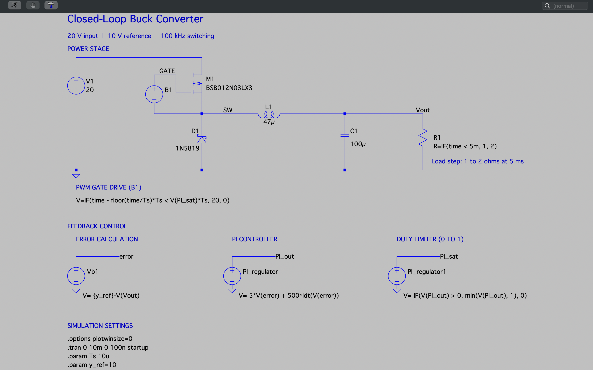
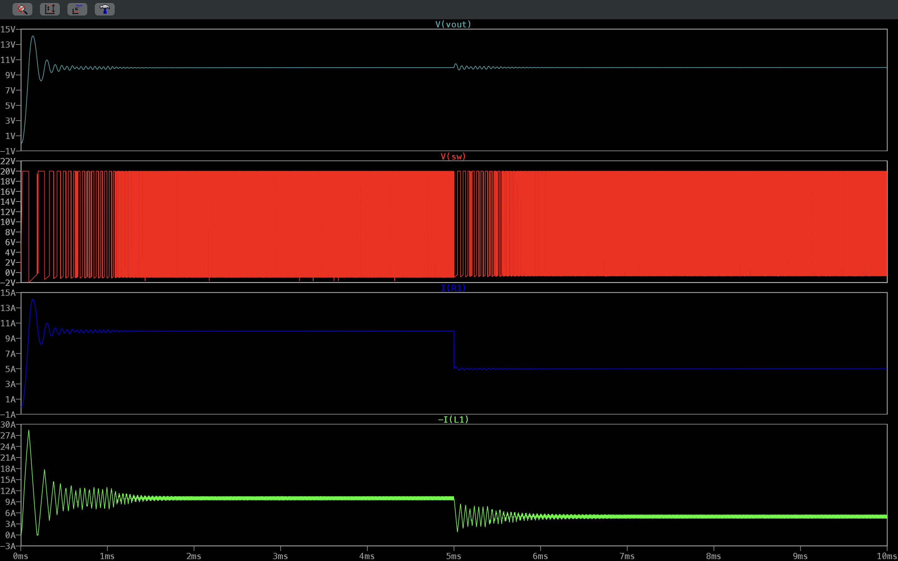
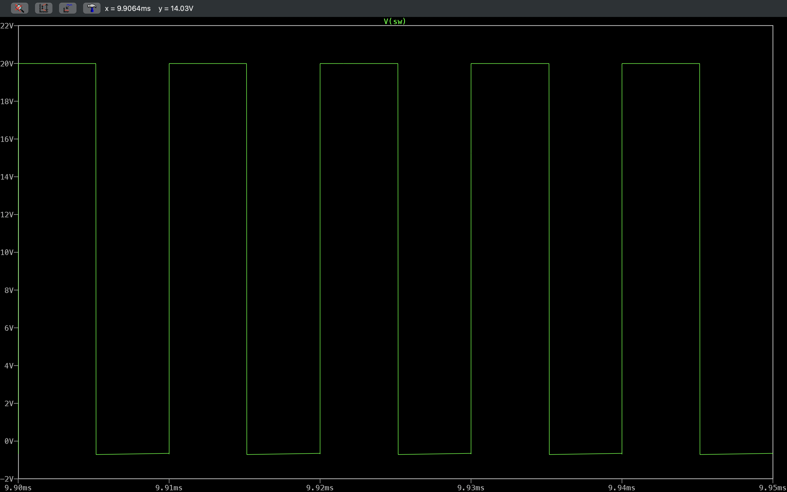

# Closed-Loop Buck Converter


This LTspice study models a 20 V to 10 V fixed-frequency PWM buck stage whose duty cycle is set by a behavioral PI voltage-feedback loop. The directory contains the native schematic, a schematic capture, and two transient captures: a full 0-10 ms run covering startup and a load step, and a steady-state zoom of the switching node.

The engineering question is how the output voltage and inductor current behave when the converter starts from rest and when the load resistance doubles at 5 ms. The controller, limiter, and PWM modulator are idealized behavioral sources, so the study shows loop behavior in simulation rather than the performance of a physical gate driver or controller IC.

## Table of Contents

- [Schematic](#schematic)
- [Simulation Plots](#simulation-plots)
- [Overview](#overview)
- [Specifications](#specifications)
- [Results](#results)
- [Simulation Setup](#simulation-setup)
- [Running the Simulation](#running-the-simulation)
- [Tech Stack](#tech-stack)
- [Tools and Environment](#tools-and-environment)
- [Repository Structure](#repository-structure)
- [References and Attribution](#references-and-attribution)
- [Contact](#contact)
- [License](#license)

## Schematic

[](Docs/Images/Schematics/Closed_Loop_Buck_Converter_Schematic.png)

Native LTspice source: [Closed_Loop_Buck_Converter_Simulation.asc](Simulation/LTspice_Files/Closed_Loop_Buck_Converter_Simulation.asc)

## Simulation Plots

### Startup and Load-Step Response

[](Docs/Images/Plots/Closed_Loop_Buck_Converter_Plot_Transient_Output_And_Switching_Node_Voltages_And_Load_And_Inductor_Currents_Startup_And_Load_Step_Response.png)

*Transient analysis, 0-10 ms, four stacked panes: output voltage `V(vout)`, switching-node voltage `V(sw)`, load current `I(R1)`, and inductor current `-I(L1)`. The output overshoots to about 14 V during startup, rings, and settles near 10 V. At 5 ms the load changes from 1 Ω to 2 Ω, the load current steps from about 10 A to about 5 A, and the output shows a small, decaying disturbance.*

### Steady-State Switching Node

[](Docs/Images/Plots/Closed_Loop_Buck_Converter_Plot_Transient_Switching_Node_Voltage_Steady_State_Switching_Cycle_Zoom.png)

*Transient zoom of `V(sw)` from 9.90 ms to 9.95 ms (five 10 µs periods). The node alternates between about 20 V while M1 conducts and slightly below 0 V while D1 freewheels. This is the switching-node voltage, not the MOSFET gate voltage, and it shows steady-state switching only.*

## Overview

| Section | Description |
| --- | --- |
| Input source | `V1` supplies a constant 20 V to the drain of `M1`. |
| High-side switch | `M1` (BSB012N03LX3 NMOS model) connects the input to the switching node `SW`. |
| Freewheeling diode | `D1` (1N5819 Schottky model) carries inductor current from ground to `SW` while `M1` is off. |
| Output filter | `L1` (47 µH) and `C1` (100 µF) filter the switched waveform to produce `Vout`. |
| Load step | `R1` uses `R=IF(time < 5m, 1, 2)`, changing from 1 Ω to 2 Ω at 5 ms. |
| Error calculation | `Vb1` produces `V(error) = {y_ref} - V(Vout)` with `y_ref = 10`. |
| PI controller | `PI_regulator` produces `V(PI_out) = 5*V(error) + 500*idt(V(error))`. |
| Duty limiter | `PI_regulator1` clamps the command to 0-1 and outputs `V(PI_sat)`. |
| PWM gate drive | `B1` compares a sawtooth formed from `time` and `Ts` against `V(PI_sat)*Ts` and outputs 20 V or 0 V. It is connected between `GATE` and `SW`, so the drive is referenced to the switching node. |

## Specifications

| Parameter | Value | Basis |
| --- | --- | --- |
| Input voltage | 20 V DC | Configured (`V1`) |
| Output reference | 10 V | Configured (`.param y_ref=10`) |
| Inductor | 47 µH | Configured (`L1`) |
| Output capacitor | 100 µF | Configured (`C1`) |
| Switching period / frequency | 10 µs / 100 kHz | Configured (`.param Ts 10u`) |
| Load resistance | 1 Ω for t < 5 ms, 2 Ω afterward | Configured (`R1`) |
| PI gains | Kp = 5, Ki = 500 s⁻¹ (on the error in volts) | Configured (`PI_regulator`) |
| Duty-command range | 0 to 1 | Configured (`PI_regulator1`) |
| PWM source amplitude | 20 V, referenced to `SW` | Configured (`B1`) |
| Ideal steady-state duty cycle | 0.5 | Calculated, ideal lossless continuous conduction: 10 V / 20 V |
| Ideal load current at 10 V | 10 A (1 Ω), 5 A (2 Ω) | Calculated, Ohm's law |
| Simulated interval | 0-10 ms, 100 ns maximum step | Configured (`.tran 0 10m 0 100n startup`) |

These values are simulation settings and ideal calculations. They are not physical current, thermal, or voltage ratings for a built converter.

## Results

| Quantity or Behavior | Result | Evidence | Interpretation |
| --- | --- | --- | --- |
| Startup output peak | About 14 V, near 0.13 ms | [Startup and load-step plot](Docs/Images/Plots/Closed_Loop_Buck_Converter_Plot_Transient_Output_And_Switching_Node_Voltages_And_Load_And_Inductor_Currents_Startup_And_Load_Step_Response.png) | Simulated observation. Overshoot is about 40% above the 10 V reference, read from the axis. The startup response is underdamped. |
| Output after startup | Visibly ringing at first, then flat near 10 V within roughly 1.5 ms | Same plot, `V(vout)` pane | Simulated observation (approximate, read from the screenshot). No settling-band criterion was defined or measured. |
| Load-step disturbance | Small bump just above 10 V at 5 ms that decays over roughly 1 ms | Same plot, `V(vout)` pane | Simulated observation. The disturbance is much smaller than the startup transient. |
| Load current | About 10 A before 5 ms and about 5 A after | Same plot, `I(R1)` pane | Agrees with the calculated 10 A and 5 A for a 10 V output. |
| Inductor current | Peaks near 28 A during startup, then centers near 10 A and later near 5 A with a visible ripple band | Same plot, `-I(L1)` pane | Simulated observation. Average inductor current follows the load current once transients decay. |
| Switching-node waveform | About 20 V high and slightly below 0 V low, 10 µs period, roughly half on-time | [Switching-node zoom](Docs/Images/Plots/Closed_Loop_Buck_Converter_Plot_Transient_Switching_Node_Voltage_Steady_State_Switching_Cycle_Zoom.png) | Simulated observation, consistent with the 100 kHz setting and the ideal duty of 0.5. The negative level reflects Schottky diode conduction. |

**Modeling assumptions and scope.** The controller, limiter, and modulator are behavioral voltage sources with no propagation delay, gate-driver current limit, or dead time. The capacitor and inductor are ideal apart from LTspice defaults, and the 20 V source is stiff. The captures do not establish efficiency, output ripple in millivolts, loop phase margin, crossover frequency, or thermal behavior, and none of those quantities are claimed here.

## Simulation Setup

Active directives in `Closed_Loop_Buck_Converter_Simulation.asc`:

```spice
.options plotwinsize=0
.tran 0 10m 0 100n startup
.param Ts 10u
.param y_ref=10
```

- `plotwinsize=0` disables waveform compression so switching edges are preserved.
- `startup` ramps independent sources from zero at the beginning of the transient, which produces the startup behavior shown above.
- Named nodes: `Vout` (output), `SW` (switching node), `GATE` (MOSFET gate), `error`, `PI_out`, and `PI_sat` (controller signals).
- `L1` is placed with its first pin on the `Vout` side, so `I(L1)` is positive from `Vout` toward `SW`. The capture plots `-I(L1)`, which is positive for current delivered from `SW` to the output.

## Running the Simulation

1. Obtain this repository and open `Simulation/LTspice_Files/Closed_Loop_Buck_Converter_Simulation.asc` in LTspice.
2. Dependencies: the `BSB012N03LX3` MOSFET and `1N5819` diode models are in the standard LTspice component library. No custom `.lib`, `.sub`, or `.asy` files are needed.
3. Run the configured transient analysis.
4. In the waveform viewer, add these traces, one per pane to match the saved capture:
   ```text
   V(Vout)
   V(SW)
   I(R1)
   -I(L1)
   ```
5. Compare the full 0-10 ms view with the startup and load-step plot. Then zoom the `V(SW)` pane to 9.90-9.95 ms to compare with the switching-node capture.

No `.plt` plot-settings file was saved, so the pane layout does not open automatically.

## Tech Stack

| Category | Technology |
| --- | --- |
| Circuit Simulation |  |
| Version Control |  |
| Hosting |  |

## Tools and Environment

| Tool | Details |
| --- | --- |
| Simulator | LTspice. LTspice 17.2.4 is installed in the documentation environment; the version used for the original captures was not recorded. |
| Operating system | macOS |
| Device models | LTspice standard library: BSB012N03LX3 (NMOS), 1N5819 (Schottky diode) |

## Repository Structure

```text
Closed_Loop_Buck_Converter/
├── Docs/
│   └── Images/
│       ├── Plots/
│       │   ├── Closed_Loop_Buck_Converter_Plot_Transient_Output_And_Switching_Node_Voltages_And_Load_And_Inductor_Currents_Startup_And_Load_Step_Response.png   # 0-10 ms startup and load step
│       │   └── Closed_Loop_Buck_Converter_Plot_Transient_Switching_Node_Voltage_Steady_State_Switching_Cycle_Zoom.png                                               # 9.90-9.95 ms V(SW) zoom
│       └── Schematics/
│           └── Closed_Loop_Buck_Converter_Schematic.png        # Schematic capture
├── Simulation/
│   └── LTspice_Files/
│       └── Closed_Loop_Buck_Converter_Simulation.asc           # Native LTspice schematic
└── README.md
```

## References and Attribution

- This study was selected from an existing collection of LTspice example circuits and then used by James Collier for simulation, waveform inspection, schematic annotation, and documentation. The circuit topology is a standard buck converter, and it is not presented as an original invention.
- No upstream source credit, license, or URL is recorded in the local source file.
- Device models are supplied with LTspice by Analog Devices and remain subject to their terms.

## Contact

- GitHub: [@devjamescollier](https://github.com/devjamescollier)
- Email: [jwcollie@usc.edu](mailto:jwcollie@usc.edu)

## License

No repository-wide license is declared. Original circuit sources and third-party models remain subject to their respective terms.
