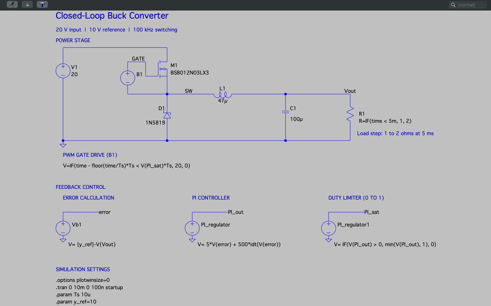
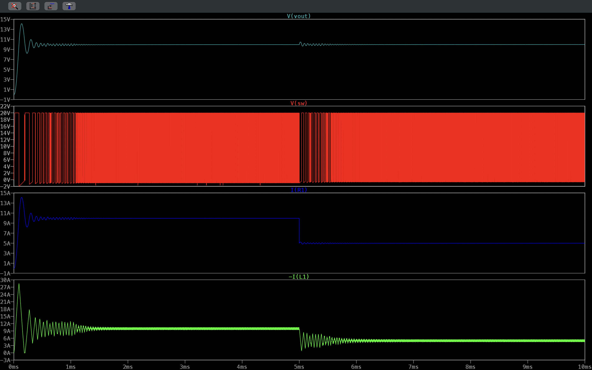
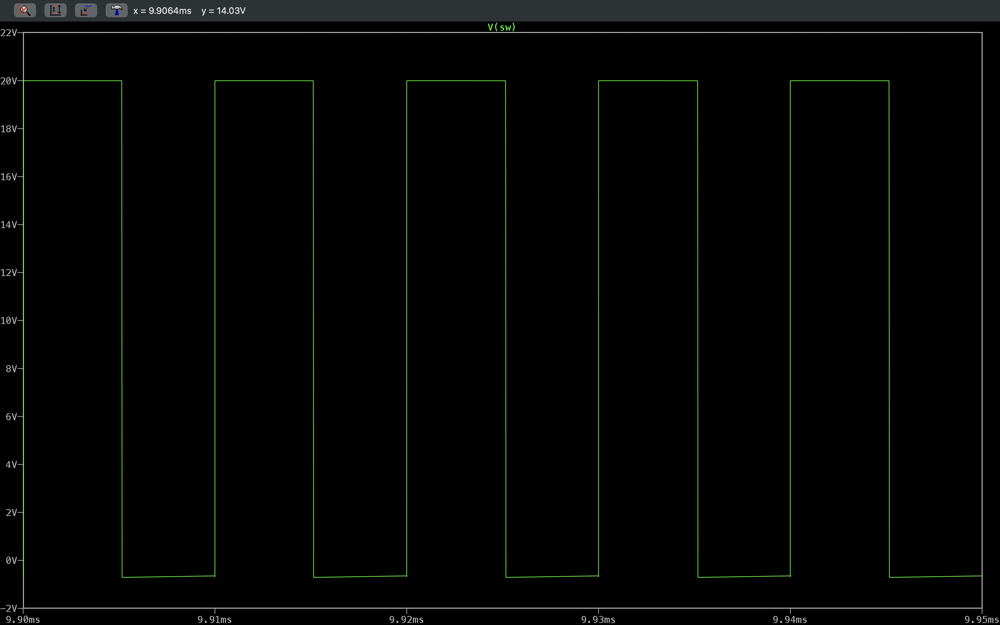

# Closed-Loop Buck Converter

[](../LICENSE)
[](https://www.analog.com/en/resources/design-tools-and-calculators/ltspice-simulator.html)

Non-synchronous 20 V to 10 V buck converter switching at 100 kHz, regulated by a behavioural PI voltage loop. A BSB012N03LX3 N-channel MOSFET and a 1N5819 Schottky freewheeling diode drive a 47 µH / 100 µF output filter, and the load steps from 1 Ω to 2 Ω at 5 ms to test the loop's transient response.

Designed to show how a closed-loop PWM controller regulates a switching converter through startup and a 50% load step, and to make the controller's behaviour visible by building it from separate error, PI, limiter, and PWM blocks.

## Table of Contents
- [Schematic](#schematic)
- [Plots](#plots)
- [Overview](#overview)
- [Specifications](#specifications)
- [Results](#results)
- [Software](#software)
- [Tech Stack](#tech-stack)
- [Repository Structure](#repository-structure)
- [Contact](#contact)
- [License](#license)

## Schematic


## Plots

### Startup and Load-Step Response
From top to bottom: output voltage V(vout), switching node V(sw), load current I(R1), and inductor current I(L1) over the full 10 ms run.



### Steady-State Switching Cycle
Switching node V(sw) from 9.90 ms to 9.95 ms, five full switching periods with the 2 Ω load.



## Overview

The circuit is split into a power stage and a feedback controller built entirely from behavioural voltage sources, so every signal in the loop can be probed directly.

| Section                  | Description |
| ------------------------ | ----------- |
| **Power Stage**          | V1 (20 V) feeds the high-side MOSFET M1. When M1 is off, D1 freewheels the inductor current. L1 and C1 form the second-order output filter, and R1 is the load. |
| **Load Step**            | R1 is defined as `R=IF(time < 5m, 1, 2)`, so the load current halves from 10 A to 5 A at 5 ms. |
| **Error Calculation**    | Vb1 computes `error = y_ref − V(Vout)` with `y_ref = 10 V`. |
| **PI Controller**        | PI_regulator computes `PI_out = 5·error + 500·∫error dt` (K<sub>p</sub> = 5, K<sub>i</sub> = 500 s⁻¹). |
| **Duty Limiter**         | PI_regulator1 clamps PI_out to the range 0 to 1, producing the duty cycle PI_sat. |
| **PWM Gate Drive**       | B1 compares a 10 µs sawtooth, `time − floor(time/Ts)·Ts`, against `PI_sat·Ts`. It outputs 20 V for the on-time and 0 V otherwise. B1 is connected between GATE and SW, so it acts as an ideal floating high-side driver with V<sub>GS</sub> = 20 V. |

### Design Calculations

| Quantity | Formula | Value |
| --- | --- | --- |
| **Ideal duty cycle** | D = V<sub>out</sub> / V<sub>in</sub> | 0.50 |
| **Duty cycle with diode drop** | D = (V<sub>out</sub> + V<sub>F</sub>) / (V<sub>in</sub> + V<sub>F</sub>), V<sub>F</sub> ≈ 0.65 V | ≈ 0.52 |
| **Inductor ripple current** | ΔI<sub>L</sub> = (V<sub>in</sub> − V<sub>out</sub>)·D / (L·f<sub>sw</sub>) | ≈ 1.1 A<sub>pp</sub> |
| **Output ripple voltage** | ΔV = ΔI<sub>L</sub> / (8·f<sub>sw</sub>·C) | ≈ 13 mV<sub>pp</sub> (ideal capacitor) |
| **LC resonance** | f<sub>0</sub> = 1 / (2π√(LC)) | 2.32 kHz |
| **PI zero** | ω<sub>z</sub> = K<sub>i</sub> / K<sub>p</sub> | 100 rad/s (15.9 Hz) |

## Specifications

| Parameter                 | Value |
| ------------------------- | ----- |
| **Topology**              | Non-synchronous buck, voltage-mode PI control |
| **Input Voltage**         | 20 V |
| **Output Reference**      | 10 V (`.param y_ref=10`) |
| **Switching Frequency**   | 100 kHz (`.param Ts 10u`) |
| **Switch**                | BSB012N03LX3 N-channel MOSFET |
| **Freewheeling Diode**    | 1N5819 Schottky |
| **Inductor**              | 47 µH |
| **Output Capacitor**      | 100 µF |
| **Load**                  | 1 Ω (10 A) for 0–5 ms, 2 Ω (5 A) for 5–10 ms |
| **Controller Gains**      | K<sub>p</sub> = 5, K<sub>i</sub> = 500 s⁻¹ |
| **Duty Cycle Range**      | 0 to 1 |
| **Analysis**              | `.tran 0 10m 0 100n startup` |

## Results

Values read from the LTspice waveform viewer:

| Measurement               | Expected        | Simulated          | Notes |
| ------------------------: | --------------: | -----------------: | ----: |
| **Regulated output**      | 10.0 V          | 10.0 V             | Before and after the load step |
| **Load current**          | 10 A / 5 A      | 10 A / 5 A         | 1 Ω and 2 Ω |
| **Startup overshoot**     | —               | 14.1 V at ≈ 0.13 ms | 41% above the reference |
| **Startup settling**      | —               | ≈ 1.5 ms           | Oscillation decays into the switching ripple |
| **Peak inductor current** | —               | ≈ 28.5 A           | First startup current peak |
| **Load-step deviation**   | —               | ≈ +0.5 V           | Recovers in ≈ 1.5 ms |
| **Switching period**      | 10 µs           | 10 µs              | 100 kHz |
| **On-time / duty cycle**  | 5.2 µs / 0.52   | ≈ 5.1 µs / 0.51    | 2 Ω load, 9.90–9.95 ms |
| **Switching node low**    | −V<sub>F</sub>  | ≈ −0.7 V           | D1 conducting during the off-time |

### Discussion

**Regulation.** The integrator drives the steady-state error to zero, so the output sits at 10.0 V both before and after the load step. The measured on-time of ≈ 5.1 µs is slightly above V<sub>out</sub>/V<sub>in</sub> = 0.50. The extra duty makes up for the ≈ 0.7 V drop across D1 during the off-time, which can be seen as the negative switching-node level in the zoomed plot.

**Startup.** At t = 0 the error is 10 V and the PI output is far above 1, so the limiter holds the duty cycle at 100% and the switching node stays at 20 V for the first ≈ 80 µs. The full 20 V across the LC filter pushes the inductor current to ≈ 28.5 A and the output to 14.1 V. The integrator also keeps accumulating error while the duty cycle is saturated, because the controller has no anti-windup, and this adds to the overshoot. Once the output passes the reference, the duty cycle drops to 0 and the switching node shows long off-periods until the loop recovers. Adding anti-windup (integrator clamping or back-calculation) or a soft-start ramp on `y_ref` would remove most of the overshoot.

**Load step.** When R1 changes from 1 Ω to 2 Ω, the inductor is still carrying 10 A, and the extra 5 A charges C1 and raises the output by ≈ 0.5 V. The loop briefly cuts the duty cycle, which is visible as a burst of wide off-periods on V(sw) at 5 ms. The inductor current then rings down to the new 5 A average at roughly the LC resonance before settling. The output deviation is much smaller than at startup because the duty cycle never stays saturated for long.

**Ripple.** The inductor current band in steady state is about 1 A wide, which agrees with the calculated 1.1 A<sub>pp</sub>. Output voltage ripple is too small to resolve on the 15 V scale, which is consistent with the ≈ 13 mV<sub>pp</sub> calculated for an ideal 100 µF capacitor.

### Limitations

- The gate driver is an ideal floating source; real high-side drive needs a bootstrap or isolated supply. The 20 V gate drive is also at the BSB012N03LX3's ±20 V V<sub>GS</sub> limit.
- C1 and L1 are ideal: no ESR, ESL, DCR, or core saturation. With a real capacitor, ESR would dominate the output ripple.
- The controller is continuous-time and behavioural; it has no sampling delay, no compensation network, and no anti-windup.
- No efficiency or loss analysis was performed.

## Software

### Running

1. Install LTspice (tested with 17.2.4).
2. Open [`Simulation/LTspice_Files/Closed_Loop_Buck_Converter_Simulation.asc`](Simulation/LTspice_Files/Closed_Loop_Buck_Converter_Simulation.asc).
3. Run the simulation; the `.tran`, `.param`, and `.options` directives are on the schematic.
4. Probe `Vout`, `SW`, R1, and L1 to reproduce the startup and load-step plot. Plot `-I(L1)` so the inductor current reads positive.
5. Zoom V(sw) to 9.90–9.95 ms to reproduce the switching-cycle plot.
6. Change `y_ref`, `Ts`, or the PI gains in the directives and behavioural sources to explore other operating points.

## Tech Stack

| Circuit Simulation | Version Control | Repository Hosting |
| :----------------: | :-------------: | :----------------: |
|  |  |  |

## Repository Structure

```text
Closed_Loop_Buck_Converter
├── Docs                                                                           Contains simulation images
│   └── Images
│       ├── Plots                                                                  Contains exported waveform plots
│       │   ├── Closed_Loop_Buck_Converter_Plot_Transient_Output_And_Switching_Node_Voltages_And_Load_And_Inductor_Currents_Startup_And_Load_Step_Response.png
│       │   │                                                                      Output, switching node, load, and inductor waveforms, 0–10 ms
│       │   └── Closed_Loop_Buck_Converter_Plot_Transient_Switching_Node_Voltage_Steady_State_Switching_Cycle_Zoom.png
│       │                                                                          Switching node, 9.90–9.95 ms
│       └── Schematics                                                             Contains the schematic image
│           └── Closed_Loop_Buck_Converter_Schematic.png                           Schematic in PNG format
├── Simulation
│   └── LTspice_Files
│       └── Closed_Loop_Buck_Converter_Simulation.asc                              LTspice schematic and simulation file
└── README.md                                                                      Simulation README
```

## Contact
- GitHub: [@devjamescollier](https://github.com/devjamescollier)
- Email: [jwcollie@usc.edu](mailto:jwcollie@usc.edu)

## License

Copyright © 2026 James Collier

This project is licensed under the MIT License. See [LICENSE](../LICENSE).
