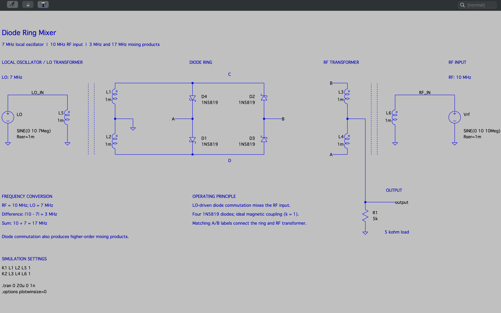
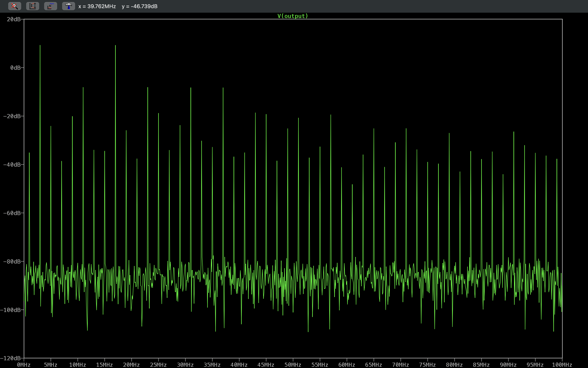
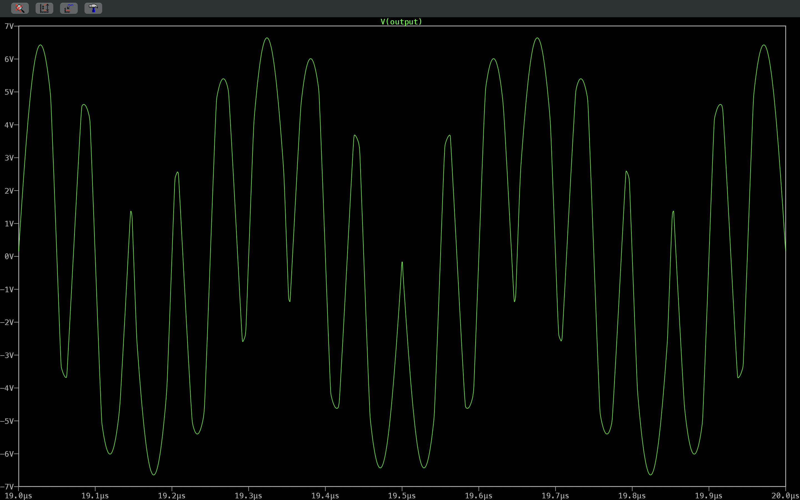
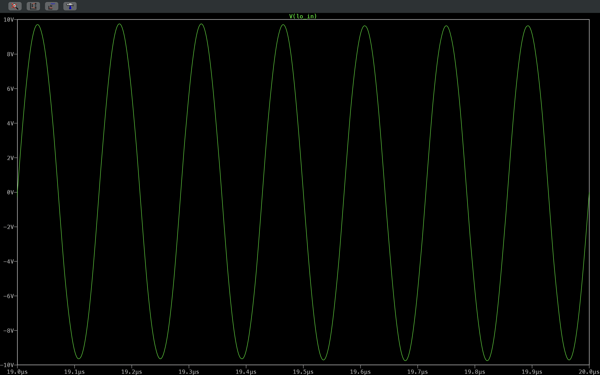
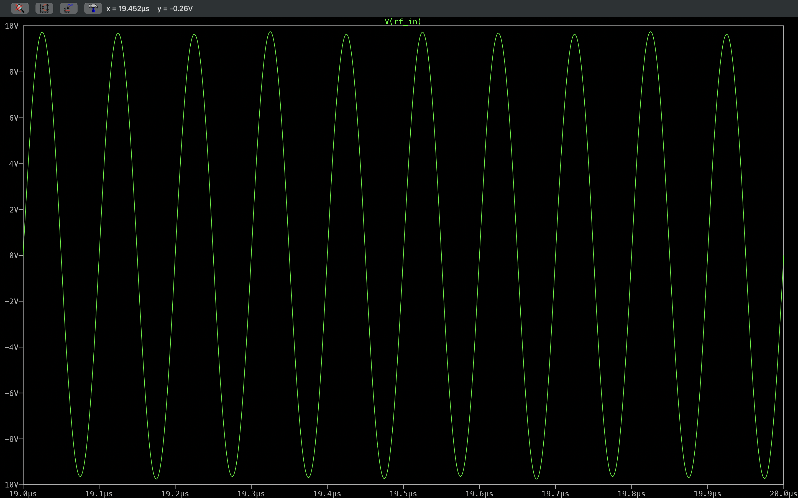

# Diode Ring Mixer


This LTspice study models a double-balanced diode ring mixer. A 7 MHz local oscillator (LO) commutates four Schottky diodes to translate a 10 MHz RF input to new frequencies. The directory contains the native schematic, a schematic capture, transient captures of the LO input, RF input, and mixer output, and two FFT views of the output voltage spanning 0-40 MHz and 0-100 MHz.

The engineering question is which frequency products a diode-commutated mixer creates and how strong they are relative to one another. The transformers are ideal coupled inductors and the ports are driven by voltage sources, so the study shows frequency translation in simulation. It does not characterize an RF-matched mixer.

## Table of Contents

- [Schematic](#schematic)
- [Simulation Plots](#simulation-plots)
- [Overview](#overview)
- [Specifications](#specifications)
- [Results](#results)
- [Simulation Setup](#simulation-setup)
- [Running the Simulation](#running-the-simulation)
- [Tech Stack](#tech-stack)
- [Tools and Environment](#tools-and-environment)
- [Repository Structure](#repository-structure)
- [References and Attribution](#references-and-attribution)
- [Contact](#contact)
- [License](#license)

## Schematic

[](Docs/Images/Schematics/Diode_Ring_Mixer_Schematic.png)

Native LTspice source: [Diode_Ring_Mixer_Simulation.asc](Simulation/LTspice_Files/Diode_Ring_Mixer_Simulation.asc)

## Simulation Plots

### Output Spectrum, 0-40 MHz

[](Docs/Images/Plots/Diode_Ring_Mixer_Plot_FFT_Output_Voltage_Spectrum_0_To_40_Megahertz.png)

*FFT of the transient `V(output)` waveform, 0-40 MHz, magnitude in dB as displayed by LTspice. The two strongest lines are at about 3 MHz and 17 MHz, the difference and sum products, both near +9 dB on the plot scale. The next group, near −8 dB, sits at about 11, 23, 31, and 37 MHz. Every visible line falls on an odd multiple of 1 MHz.*

### Output Spectrum, 0-100 MHz

[](Docs/Images/Plots/Diode_Ring_Mixer_Plot_FFT_Output_Voltage_Spectrum_0_To_100_Megahertz.png)

*The same output FFT over a wider 0-100 MHz span. The 3 MHz and 17 MHz products remain strongest. Higher-order products continue across the band and generally become weaker at higher frequencies.*

### Mixer Output Waveform

[](Docs/Images/Plots/Diode_Ring_Mixer_Plot_Transient_Mixed_Output_Voltage_Time_Domain_Waveform.png)

*Transient `V(output)` at the RF-transformer center tap, 19-20 µs. The waveform is a non-sinusoidal mix of products with peaks of about ±6.6 V. The calculated common period of the 7 MHz and 10 MHz signals is 1 µs, which equals the full width of this view.*

### LO Input

[](Docs/Images/Plots/Diode_Ring_Mixer_Plot_Transient_Local_Oscillator_Input_Voltage_7_Megahertz_Waveform.png)

*Transient `V(lo_in)`, 19-20 µs: seven cycles per microsecond (7 MHz), with peaks close to the 10 V source amplitude (about 9.7 V on the axis).*

### RF Input

[](Docs/Images/Plots/Diode_Ring_Mixer_Plot_Transient_RF_Input_Voltage_10_Megahertz_Waveform.png)

*Transient `V(rf_in)`, 19-20 µs: ten cycles per microsecond (10 MHz), with peaks close to the 10 V source amplitude.*

## Overview

| Section | Description |
| --- | --- |
| Local oscillator | `LO` = `SINE(0 10 7Meg)`, Rser = 1 mΩ, drives net `LO_IN` and winding `L5`. |
| LO transformer | `L5` (primary) is coupled to `L1` and `L2` (center-tapped secondary, center tap grounded) with `K1 L1 L2 L5 1`. |
| Diode ring | `D1`-`D4` (1N5819 Schottky models) form a ring between ring nodes `C` and `D` (LO secondary ends) and `A` and `B`. |
| RF transformer | `L3` and `L4` (center-tapped winding, ends on `B` and `A`) are coupled to `L6` with `K2 L3 L4 L6 1`. |
| RF input | `Vrf` = `SINE(0 10 10Meg)`, Rser = 1 mΩ, drives net `RF_IN` and winding `L6`. |
| Output | The `L3`/`L4` center tap is net `output`, loaded by `R1` = 5 kΩ to ground. |
| Operation | The LO alternately switches diode pairs on, which multiplies the RF signal by an LO-controlled ±1 switching function. Diode nonlinearity and commutation also produce higher-order products. |

## Specifications

| Parameter | Value | Basis |
| --- | --- | --- |
| LO source | 10 V peak, 7 MHz, Rser = 1 mΩ | Configured (`LO`) |
| RF source | 10 V peak, 10 MHz, Rser = 1 mΩ | Configured (`Vrf`) |
| Diodes | 4 × 1N5819 | Configured |
| Windings | 6 × 1 mH (`L1`-`L6`) | Configured |
| Coupling | k = 1 (ideal) for `K1` and `K2` | Configured |
| Output load | 5 kΩ | Configured (`R1`) |
| Difference product | 3 MHz | Calculated: \|10 MHz − 7 MHz\| |
| Sum product | 17 MHz | Calculated: 10 MHz + 7 MHz |
| Third-order LO-harmonic products | 11 MHz and 31 MHz | Calculated: \|3·7 ∓ 10\| MHz |
| Third-order RF-harmonic products | 23 MHz and 37 MHz | Calculated: \|3·10 ∓ 7\| MHz |
| Transient analysis | 0-20 µs, 1 ns maximum step | Configured (`.tran 0 20u 0 1n`) |

The 1 mH windings and 10 V-peak sources are simulation settings chosen to show commutation clearly. They are not values for a practical broadband RF transformer or a typical LO drive level.

## Results

| Quantity or Behavior | Result | Evidence | Interpretation |
| --- | --- | --- | --- |
| LO frequency | 7 cycles in 1 µs (7 MHz) | [LO input](Docs/Images/Plots/Diode_Ring_Mixer_Plot_Transient_Local_Oscillator_Input_Voltage_7_Megahertz_Waveform.png) | Simulated observation, matching the configured source. |
| RF frequency | 10 cycles in 1 µs (10 MHz) | [RF input](Docs/Images/Plots/Diode_Ring_Mixer_Plot_Transient_RF_Input_Voltage_10_Megahertz_Waveform.png) | Simulated observation, matching the configured source. |
| Dominant output products | Peaks at about 3 MHz and 17 MHz, the highest on both FFT views | [0-40 MHz FFT](Docs/Images/Plots/Diode_Ring_Mixer_Plot_FFT_Output_Voltage_Spectrum_0_To_40_Megahertz.png) | Simulated observation, agreeing with the calculated difference and sum frequencies. |
| Next strongest products | About 11, 23, 31, and 37 MHz, roughly 17 dB below the main pair on the plot scale | Same plot | Simulated observation, consistent with the calculated third-order products. |
| LO and RF feedthrough | A small line at 7 MHz, far below the main products. No distinct line is visible at 10 MHz above the plotted floor. | Same plot | Simulated observation of balanced-mixer suppression in this ideal, symmetric model. |
| Wideband behavior | Odd-MHz products continue to 100 MHz and generally decline | [0-100 MHz FFT](Docs/Images/Plots/Diode_Ring_Mixer_Plot_FFT_Output_Voltage_Spectrum_0_To_100_Megahertz.png) | Simulated observation |
| Output waveform | Non-sinusoidal, about ±6.6 V peak; 1 µs calculated common period of LO and RF | [Output waveform](Docs/Images/Plots/Diode_Ring_Mixer_Plot_Transient_Mixed_Output_Voltage_Time_Domain_Waveform.png) | Simulated observation |

**Plot type and scope.** The FFT views show LTspice's FFT magnitude of the output voltage in dB. They are not power spectra in dBm, power spectral densities, or conversion-loss measurements. The FFT window and transform settings used for the captures were not recorded, so absolute dB levels and the floor near −85 to −90 dB should be compared only within each plot. Port impedance matching, conversion loss, isolation, noise figure, and intercept points are not established by this ideal-coupling, voltage-source model.

## Simulation Setup

Active directives in `Diode_Ring_Mixer_Simulation.asc`:

```spice
K1 L1 L2 L5 1
K2 L3 L4 L6 1
.tran 0 20u 0 1n
.options plotwinsize=0
```

- Named nets: `LO_IN`, `RF_IN`, and `output`, plus ring nets `A` and `B`, which connect the ring to the RF transformer through matching labels. `C` and `D` are text annotations on the drawing, not net labels.
- `plotwinsize=0` disables waveform compression, which matters for FFT accuracy.
- The 1 ns maximum time step gives many points per period of the highest products shown.

## Running the Simulation

1. Obtain this repository and open `Simulation/LTspice_Files/Diode_Ring_Mixer_Simulation.asc` in LTspice.
2. Dependencies: the `1N5819` model is in the standard LTspice diode library. No custom files are needed.
3. Run the configured transient analysis.
4. Plot the time-domain traces and zoom to 19-20 µs to compare with the captures:
   ```text
   V(LO_IN)
   V(RF_IN)
   V(output)
   ```
5. With the `V(output)` pane active, choose **View → FFT** and select `V(output)`. Set the frequency axis to 0-40 MHz or 0-100 MHz to compare with the two saved spectrum views. The original FFT window, point count, and time range were not recorded, so choose and document your own settings.

## Tech Stack

| Category | Technology |
| --- | --- |
| Circuit Simulation |  |
| Version Control |  |
| Hosting |  |

## Tools and Environment

| Tool | Details |
| --- | --- |
| Simulator | LTspice. LTspice 17.2.4 is installed in the documentation environment; the version used for the original captures was not recorded. |
| Operating system | macOS |
| Device models | 1N5819 Schottky diode from the LTspice standard library |

## Repository Structure

```text
Diode_Ring_Mixer/
├── Docs/
│   └── Images/
│       ├── Plots/
│       │   ├── Diode_Ring_Mixer_Plot_FFT_Output_Voltage_Spectrum_0_To_100_Megahertz.png              # Wide FFT view
│       │   ├── Diode_Ring_Mixer_Plot_FFT_Output_Voltage_Spectrum_0_To_40_Megahertz.png               # Close FFT view
│       │   ├── Diode_Ring_Mixer_Plot_Transient_Local_Oscillator_Input_Voltage_7_Megahertz_Waveform.png  # V(LO_IN)
│       │   ├── Diode_Ring_Mixer_Plot_Transient_Mixed_Output_Voltage_Time_Domain_Waveform.png         # V(output)
│       │   └── Diode_Ring_Mixer_Plot_Transient_RF_Input_Voltage_10_Megahertz_Waveform.png            # V(RF_IN)
│       └── Schematics/
│           └── Diode_Ring_Mixer_Schematic.png        # Schematic capture
├── Simulation/
│   └── LTspice_Files/
│       └── Diode_Ring_Mixer_Simulation.asc           # Native LTspice schematic
└── README.md
```

## References and Attribution

- This study was selected from an existing collection of LTspice example circuits and then used by James Collier for simulation, waveform and spectrum inspection, schematic annotation, and documentation. The double-balanced diode ring mixer is a standard topology and is not presented as an original invention.
- No upstream source credit, license, or URL is recorded in the local source file.
- The 1N5819 model is supplied with LTspice and remains subject to its terms.

## Contact

- GitHub: [@devjamescollier](https://github.com/devjamescollier)
- Email: [jwcollie@usc.edu](mailto:jwcollie@usc.edu)

## License

No repository-wide license is declared. Original circuit sources and third-party models remain subject to their respective terms.
