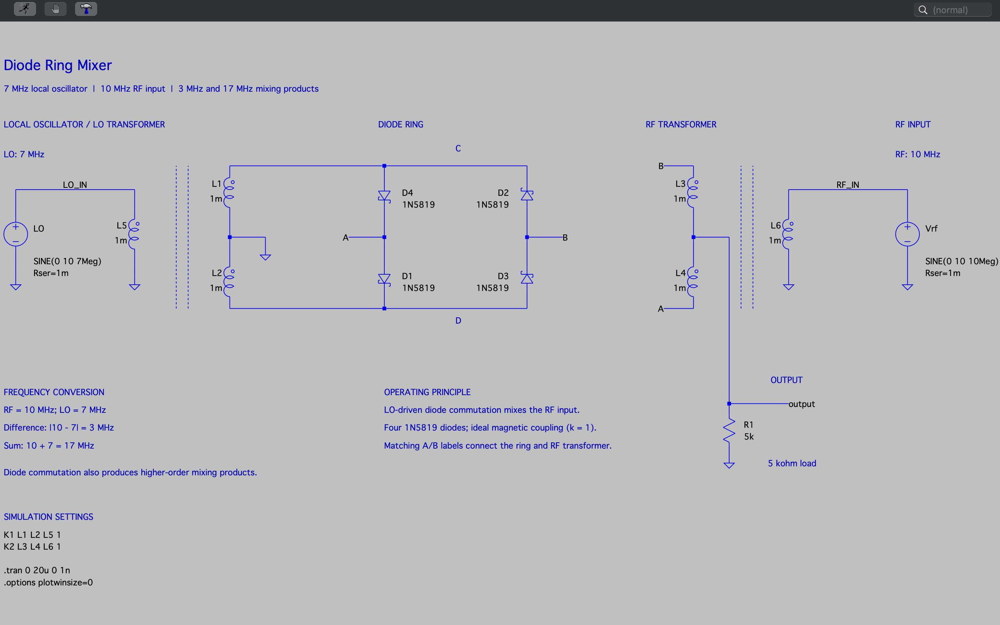
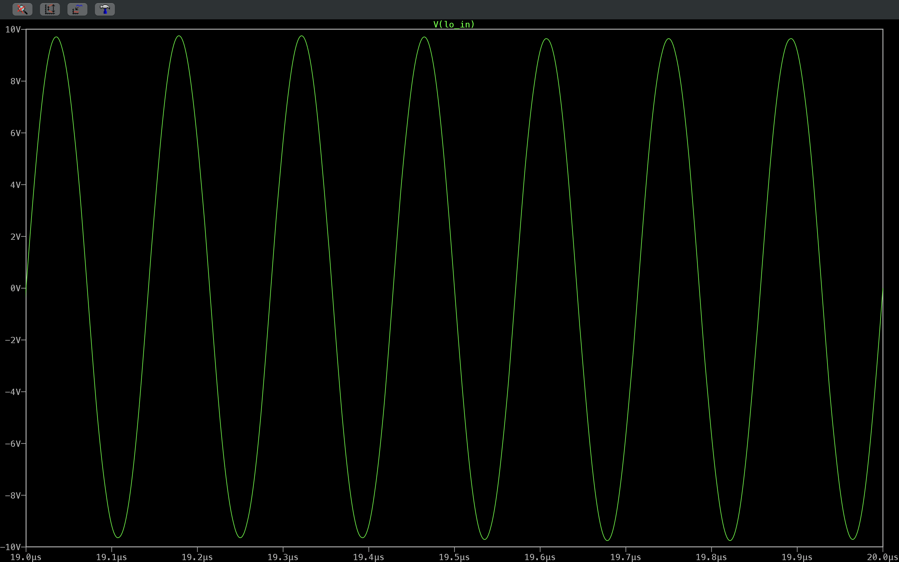
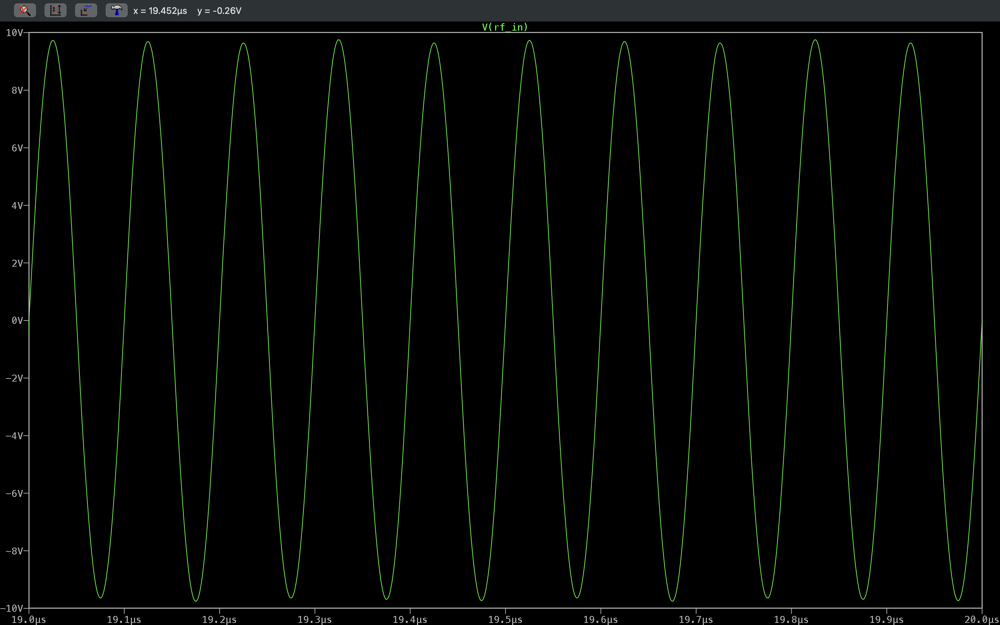
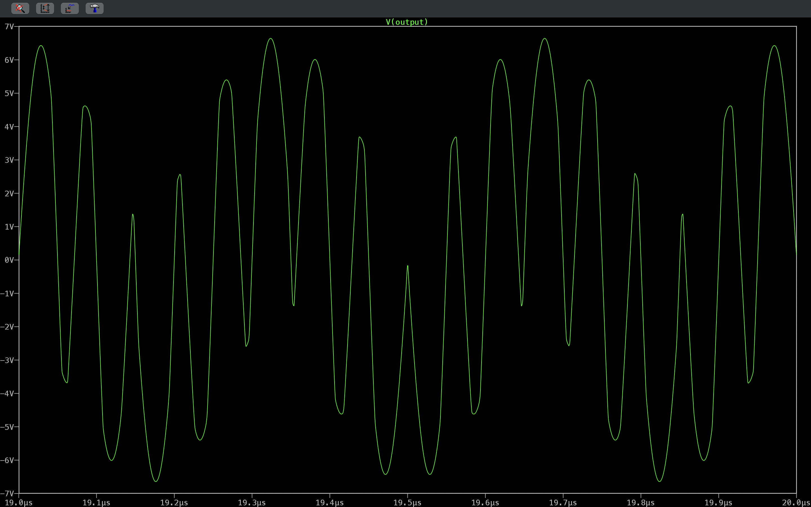
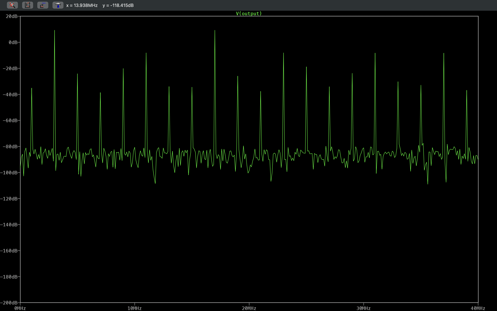
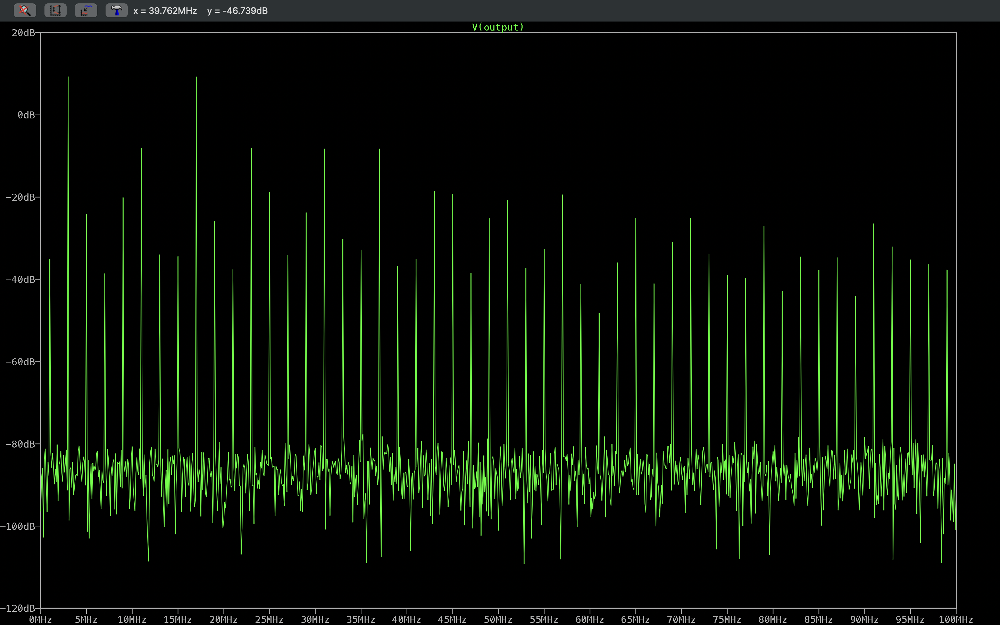

# Diode Ring Mixer

[](../LICENSE)
[](https://www.analog.com/en/resources/design-tools-and-calculators/ltspice-simulator.html)

Double-balanced diode ring mixer built from four 1N5819 Schottky diodes and two center-tapped, ideally coupled transformers. A 7 MHz local oscillator commutates the ring, and a 10 MHz RF input is translated into difference (3 MHz) and sum (17 MHz) products at the IF output across a 5 kΩ load.

Designed to show frequency conversion by switching rather than multiplication, and to use the FFT to separate the wanted mixing products from higher-order spurs and LO and RF feedthrough.

## Table of Contents
- [Schematic](#schematic)
- [Plots](#plots)
- [Overview](#overview)
- [Specifications](#specifications)
- [Results](#results)
- [Software](#software)
- [Tech Stack](#tech-stack)
- [Repository Structure](#repository-structure)
- [Contact](#contact)
- [License](#license)

## Schematic


## Plots

### Input Waveforms (19–20 µs)
| Local Oscillator, 7 MHz | RF Input, 10 MHz |
| :---: | :---: |
|  |  |

### Mixed Output (19–20 µs)


### Output Spectrum
| 0–40 MHz | 0–100 MHz |
| :---: | :---: |
|  |  |

## Overview

The mixer is a standard double-balanced ring. The LO drives one diagonal of the ring (C–D), and the RF transformer drives the other diagonal (A–B). The IF is taken from the RF transformer's center tap.

| Section                  | Description |
| ------------------------ | ----------- |
| **LO Transformer**       | L5 (primary) is driven by the 7 MHz LO source. L1 and L2 form a center-tapped secondary with the tap grounded. The ends connect to ring nodes C and D. All three windings are 1 mH and coupled with k = 1 (`K1 L1 L2 L5 1`). |
| **Diode Ring**           | D4, D1, D3, and D2 form a closed loop C → A → D → B → C, all pointing the same way around the ring. On each LO half-cycle one opposite pair conducts, so the ring acts as a reversing switch. |
| **RF Transformer**       | L6 (primary) is driven by the 10 MHz RF source. L3 and L4 form a center-tapped secondary connected to ring nodes B and A through matching net labels (`K2 L3 L4 L6 1`). |
| **IF Output**            | The RF secondary's center tap is the `output` node, loaded by R1 = 5 kΩ to ground. |

### Operating Principle

When the LO is large enough to switch the diodes hard, the ring multiplies the RF signal by a ±1 square wave at the LO frequency. A ±1 square wave contains only odd harmonics of f<sub>LO</sub>:

`s(t) = (4/π)[cos ω_LO t + (1/3)cos 3ω_LO t + (1/5)cos 5ω_LO t + …]`

Multiplying this by the RF input therefore produces products at |m·f<sub>LO</sub> ± f<sub>RF</sub>| for odd m. The fundamental gives the wanted products:

| Product | Frequency |
| --- | --- |
| **Difference** (f<sub>RF</sub> − f<sub>LO</sub>) | 3 MHz |
| **Sum** (f<sub>RF</sub> + f<sub>LO</sub>) | 17 MHz |
| **3rd LO harmonic** (3f<sub>LO</sub> ± f<sub>RF</sub>) | 11 MHz, 31 MHz |

Because both transformers are balanced, the LO and RF signals ideally cancel at the IF port. Diode nonlinearity at large RF drive also creates products with higher RF orders, such as 3f<sub>RF</sub> ± f<sub>LO</sub> = 23 MHz and 37 MHz.

## Specifications

| Parameter                  | Value |
| -------------------------- | ----- |
| **Topology**               | Double-balanced diode ring |
| **Diodes**                 | 4 × 1N5819 Schottky |
| **LO**                     | 7 MHz, 10 V peak, R<sub>ser</sub> = 1 mΩ |
| **RF**                     | 10 MHz, 10 V peak, R<sub>ser</sub> = 1 mΩ |
| **Transformers**           | 2 × three-winding, 1 mH per winding, k = 1, center-tapped secondary |
| **IF Load**                | 5 kΩ |
| **Analysis**               | `.tran 0 20u 0 1n` (1 ns maximum step) |
| **FFT Window**             | Taken from the transient output |

## Results

Values read from the LTspice waveform and FFT viewers. FFT levels are in dBV (dB relative to 1 V).

| Measurement               | Expected            | Simulated        | Notes |
| ------------------------: | ------------------: | ---------------: | ----: |
| **LO amplitude**          | 10 V peak           | ≈ 9.7 V peak     | V(lo_in), 7 cycles in 1 µs |
| **RF amplitude**          | 10 V peak           | ≈ 9.7 V peak     | V(rf_in), 10 cycles in 1 µs |
| **IF time-domain peak**   | —                   | ≈ ±6.6 V         | V(output), repeats every 1 µs |
| **Difference product**    | 3 MHz               | 3 MHz, ≈ +9 dBV  | ≈ 2.8 V peak |
| **Sum product**           | 17 MHz              | 17 MHz, ≈ +9 dBV | Equal in level to the difference product |
| **Conversion loss**       | —                   | ≈ 11 dB          | 2.8 V IF from a 10 V RF input |
| **3rd-order products**    | 11, 23, 31, 37 MHz  | ≈ −8 dBV each    | ≈ 17 dB below the IF products |
| **LO feedthrough**        | Suppressed          | ≈ −38 dBV        | ≈ 47 dB below the IF products |
| **RF feedthrough**        | Suppressed          | Not visible      | No line at 10 MHz above the floor |
| **Numerical floor**       | —                   | ≈ −85 dBV        | FFT and integration noise |

### Discussion

**Frequency conversion.** The two strongest lines in the spectrum are at 3 MHz and 17 MHz, both at ≈ +9 dBV, which confirms that the ring translates the 10 MHz RF input to f<sub>RF</sub> ± f<sub>LO</sub>. The two products are equal in level, as expected for a switching mixer, which splits the RF energy evenly between the upper and lower sidebands. Either product can be selected with a filter after the mixer.

**Conversion loss.** An ideal switching mixer delivers (2/π) of the RF amplitude into each sideband, a 3.9 dB loss before any diode losses. The simulated ≈ 11 dB is higher, as expected for an RF drive equal to the LO drive: the diodes are not switched hard during the whole LO cycle, and the 1N5819's forward drop and series resistance take a larger share of the signal. Real double-balanced mixers usually reach 5–7 dB with the LO driven well above the RF level.

**Spurious products.** All visible lines fall on odd-MHz frequencies. Every combination m·7 ± n·10 that is odd needs an odd LO order m, so the absence of even-MHz lines shows that the even LO harmonics, including m = 0 (RF feedthrough at 10 MHz), cancel in the balanced ring. The next strongest lines, at 11, 23, 31, and 37 MHz, are third-order products at ≈ −8 dBV. The 0–100 MHz spectrum shows the product family extending past 90 MHz and falling slowly with frequency, which is typical of the sharp switching edges of a commutating ring.

**Isolation.** The LO line at 7 MHz sits at ≈ −38 dBV, about 47 dB below the wanted products. With perfectly matched diodes and ideal k = 1 transformers, any remaining LO at the output comes from the diodes' nonlinear capacitance and drop rather than from transformer imbalance.

**Time-domain output.** The IF waveform is the sum of the 3 MHz and 17 MHz products plus the spurs, so its envelope varies cycle to cycle. Because 7 MHz and 10 MHz share a 1 MHz common factor, the whole pattern repeats every 1 µs, and the plotted 19–20 µs window is symmetric about 19.5 µs.

### Limitations

- The transformers are ideal (k = 1, no leakage inductance, no winding capacitance, no core loss), so isolation is better than a physical build would give.
- All four diodes use the same model; real diode mismatch reduces LO and RF suppression.
- The RF drive equals the LO drive, which is far above a typical mixer's RF input level. This raises the spur levels relative to a small-signal RF input.
- The IF port is a resistive load with no diplexer or filter.

## Software

### Running

1. Install LTspice (tested with 17.2.4).
2. Open [`Simulation/LTspice_Files/Diode_Ring_Mixer_Simulation.asc`](Simulation/LTspice_Files/Diode_Ring_Mixer_Simulation.asc).
3. Run the simulation; the `.tran` directive and the `K1` and `K2` coupling statements are on the schematic.
4. Probe `LO_IN`, `RF_IN`, and `output`, and zoom to 19–20 µs to reproduce the time-domain plots.
5. With V(output) selected, open **View → FFT** and plot 0–40 MHz and 0–100 MHz to reproduce the spectra.

## Tech Stack

| Circuit Simulation | Version Control | Repository Hosting |
| :----------------: | :-------------: | :----------------: |
|  |  |  |

## Repository Structure

```text
Diode_Ring_Mixer
├── Docs                                                                           Contains simulation images
│   └── Images
│       ├── Plots                                                                  Contains exported waveform and FFT plots
│       │   ├── Diode_Ring_Mixer_Plot_FFT_Output_Voltage_Spectrum_0_To_100_Megahertz.png              Output spectrum, 0–100 MHz
│       │   ├── Diode_Ring_Mixer_Plot_FFT_Output_Voltage_Spectrum_0_To_40_Megahertz.png               Output spectrum, 0–40 MHz
│       │   ├── Diode_Ring_Mixer_Plot_Transient_Local_Oscillator_Input_Voltage_7_Megahertz_Waveform.png  7 MHz LO input
│       │   ├── Diode_Ring_Mixer_Plot_Transient_Mixed_Output_Voltage_Time_Domain_Waveform.png         IF output, 19–20 µs
│       │   └── Diode_Ring_Mixer_Plot_Transient_RF_Input_Voltage_10_Megahertz_Waveform.png            10 MHz RF input
│       └── Schematics                                                             Contains the schematic image
│           └── Diode_Ring_Mixer_Schematic.png                                     Schematic in PNG format
├── Simulation
│   └── LTspice_Files
│       └── Diode_Ring_Mixer_Simulation.asc                                        LTspice schematic and simulation file
└── README.md                                                                      Simulation README
```

## Contact
- GitHub: [@devjamescollier](https://github.com/devjamescollier)
- Email: [jwcollie@usc.edu](mailto:jwcollie@usc.edu)

## License

Copyright © 2026 James Collier

This project is licensed under the MIT License. See [LICENSE](../LICENSE).
