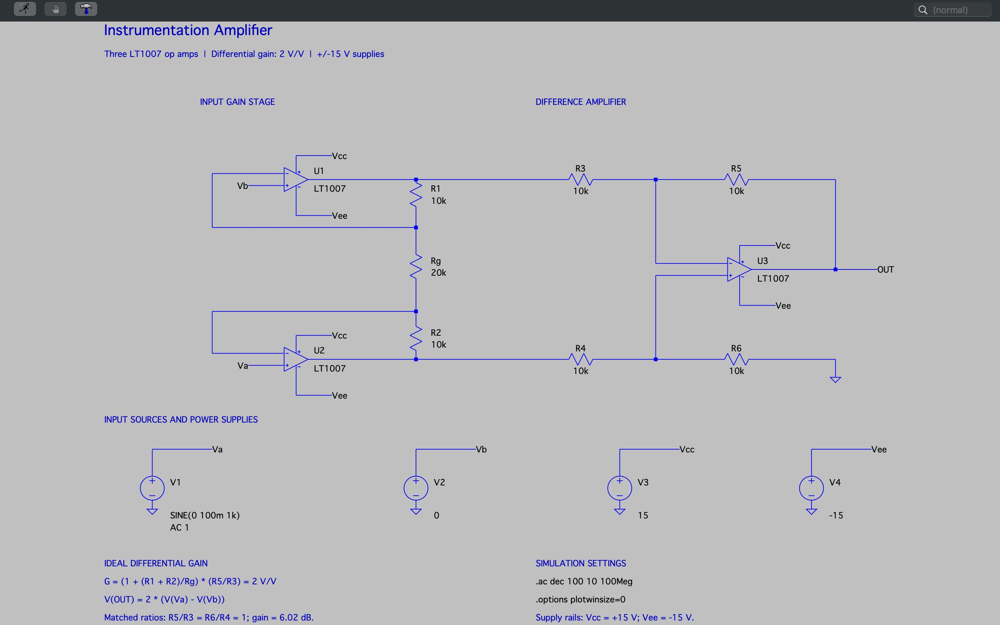
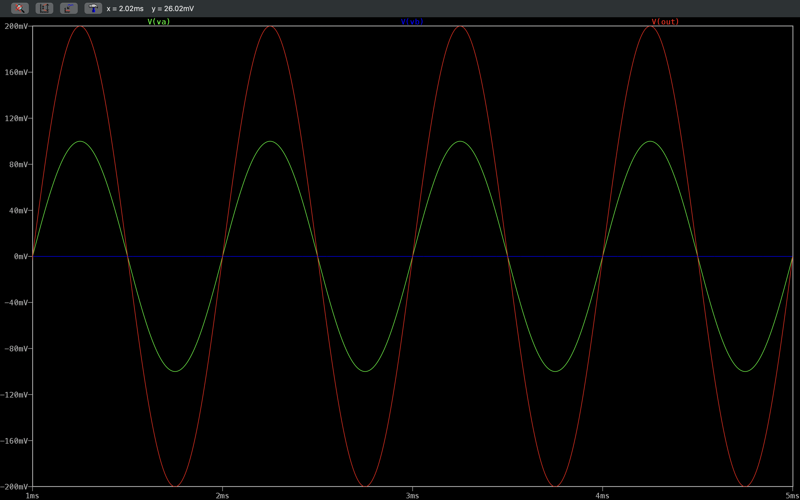
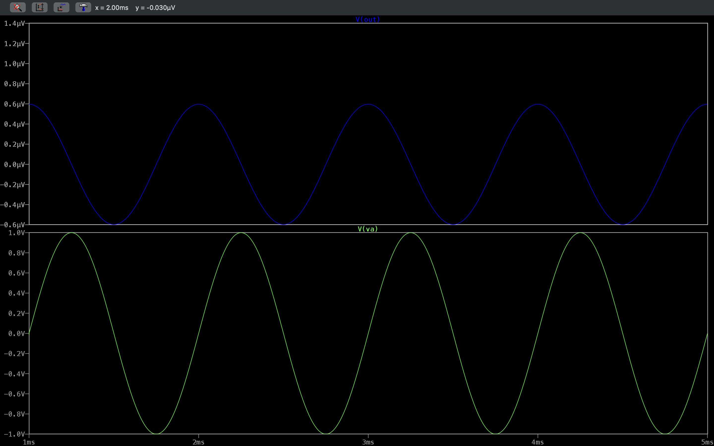
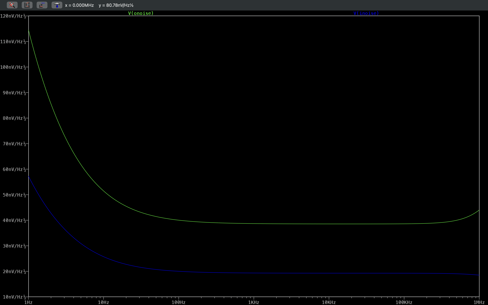

# Instrumentation Amplifier

[](../LICENSE)
[](https://www.analog.com/en/resources/design-tools-and-calculators/ltspice-simulator.html)

Classic three-op-amp instrumentation amplifier built from three LT1007 low-noise precision op amps on ±15 V supplies. Two non-inverting buffers sharing a gain resistor drive a unity-gain difference amplifier, for a differential gain of 2 V/V (6.02 dB).

Designed to verify the textbook gain equation and to measure the two properties that make an instrumentation amplifier useful for sensor front-ends: rejection of common-mode signals and low input-referred noise.

## Table of Contents
- [Schematic](#schematic)
- [Plots](#plots)
- [Overview](#overview)
- [Specifications](#specifications)
- [Results](#results)
- [Software](#software)
- [Tech Stack](#tech-stack)
- [Repository Structure](#repository-structure)
- [Contact](#contact)
- [License](#license)

## Schematic


## Plots

### Differential Signal Response
V(va) = 100 mV peak at 1 kHz, V(vb) = 0 V, and the amplifier output V(out), from 1 ms to 5 ms.



### Common-Mode Rejection Test
Both inputs driven by the same 1 V peak, 1 kHz signal. Top: V(out) on a µV scale. Bottom: V(va).



### Noise Density
Output-referred noise V(onoise) and input-referred noise V(inoise), 1 Hz to 1 MHz.



## Overview

| Section                  | Description |
| ------------------------ | ----------- |
| **Input Gain Stage**     | U1 and U2 are non-inverting amplifiers driven by V<sub>b</sub> and V<sub>a</sub>. Their inverting inputs are tied across R<sub>g</sub> = 20 kΩ, and R1 = R2 = 10 kΩ are the feedback resistors. A differential input appears amplified by (1 + (R1 + R2)/R<sub>g</sub>), while a common-mode input passes through at unity gain because no current flows in R<sub>g</sub>. |
| **Difference Amplifier** | U3 with R3–R6 = 10 kΩ subtracts the two first-stage outputs with unity gain and rejects the remaining common-mode signal. |
| **Sources and Supplies** | V1 drives V<sub>a</sub> (`SINE(0 100m 1k)`, `AC 1`), V2 holds V<sub>b</sub> at 0 V, and V3 / V4 provide ±15 V. |

### Gain Equation

`G = (1 + (R1 + R2)/Rg) · (R5/R3) = (1 + 20 kΩ / 20 kΩ) · 1 = 2 V/V`

`V(OUT) = 2 · (V(Va) − V(Vb))`

With matched ratios R5/R3 = R6/R4 = 1, the gain is set by one resistor, R<sub>g</sub>, and the difference stage contributes no gain.

### Noise Estimate

At 27 °C, a 10 kΩ resistor produces √(4kTR) = 12.9 nV/√Hz of thermal noise. Adding every source at the output:

| Source | Output Contribution |
| --- | --- |
| **R1, R2** (first-stage feedback) | 18.2 nV/√Hz (two uncorrelated 12.9 nV/√Hz sources) |
| **R<sub>g</sub>** (20 kΩ, split across both outputs) | 18.2 nV/√Hz |
| **R3, R5** (difference stage) | 18.2 nV/√Hz |
| **R4 ∥ R6** (5 kΩ, noise gain 2) | 18.2 nV/√Hz |
| **U1–U3 voltage noise** (2.5 nV/√Hz each, noise gain 2) | 8.7 nV/√Hz |
| **Total (root-sum-square)** | **37.4 nV/√Hz output, 18.7 nV/√Hz input-referred** |

About 95% of the noise power comes from the resistors, not the op amps.

## Specifications

| Parameter                     | Value |
| ----------------------------- | ----- |
| **Topology**                  | Three-op-amp instrumentation amplifier |
| **Op Amps**                   | 3 × LT1007 |
| **Supplies**                  | ±15 V |
| **Gain Resistor**             | R<sub>g</sub> = 20 kΩ |
| **Feedback Resistors**        | R1 = R2 = 10 kΩ |
| **Difference-Stage Resistors**| R3 = R4 = R5 = R6 = 10 kΩ |
| **Differential Gain**         | 2 V/V (6.02 dB) |
| **Test Signal**               | 1 kHz sine, 100 mV peak differential, 1 V peak common mode |
| **Analyses**                  | Transient, AC (`.ac dec 100 10 100Meg`), noise (1 Hz–1 MHz) |

## Results

Values read from the LTspice waveform viewer:

| Measurement                       | Expected        | Simulated          | Notes |
| --------------------------------: | --------------: | -----------------: | ----: |
| **Differential output**           | 200 mV peak     | 200 mV peak        | 100 mV peak input, in phase |
| **Differential gain**             | 2.00 V/V        | 2.00 V/V           | 6.02 dB |
| **Common-mode output**            | 0 V             | 0.6 µV peak        | 1 V peak common-mode input |
| **Common-mode gain**              | 0               | 6 × 10⁻⁷ V/V       | −124.4 dB |
| **CMRR at 1 kHz**                 | —               | ≈ 130 dB           | 20·log(2 / 6 × 10⁻⁷) |
| **Output noise, flat band**       | 37.4 nV/√Hz     | ≈ 38.5 nV/√Hz      | ≈ 100 Hz to 200 kHz |
| **Input noise, flat band**        | 18.7 nV/√Hz     | ≈ 19.3 nV/√Hz      | Output noise ÷ 2 |
| **Noise at 1 Hz**                 | —               | ≈ 115 / 57 nV/√Hz  | Output / input, 1/f region |
| **Output noise at 1 MHz**         | —               | ≈ 44 nV/√Hz        | Rises near the op-amp bandwidth limit |

### Discussion

**Differential gain.** With 100 mV on V<sub>a</sub> and V<sub>b</sub> grounded, the output is a clean 200 mV peak sine in phase with the input, which matches G = 2 V/V exactly. At 1 kHz the LT1007's open-loop gain is high enough that the closed-loop gain error is too small to see.

**Common-mode rejection.** With the same 1 V signal on both inputs, the output is only 0.6 µV peak, a common-mode gain of 6 × 10⁻⁷ and a CMRR of ≈ 130 dB. The resistors in the simulation are perfectly matched, so this residual comes from the op amps alone: the difference stage's finite loop gain and the LT1007's own common-mode rejection. The residual output is 90° out of phase with the input (a cosine against a sine), which shows that it comes from a frequency-dependent term rather than a resistive mismatch. In a real build, resistor matching in the difference stage would limit CMRR long before this. With 0.1% resistors in R3–R6, the worst-case CMRR at this gain is only about 60 dB.

**Noise.** The input-referred noise is flat at ≈ 19.3 nV/√Hz from about 100 Hz to 200 kHz, within 3% of the 18.7 nV/√Hz hand estimate. The LT1007 is a 2.5 nV/√Hz part, so the amplifier's noise is set almost entirely by the thermal noise of the 10 kΩ and 20 kΩ resistors. Below ≈ 10 Hz both curves rise with the op amps' 1/f noise, reaching 57 nV/√Hz input-referred at 1 Hz. Above 200 kHz the output noise rises as the op amps' loop gain falls and their noise is amplified more, while the input-referred curve stays flat because the signal gain falls with it.

**Design implications.** Lower-value resistors (for example 1 kΩ for R1, R2, and the difference stage, with R<sub>g</sub> scaled to match) would cut the resistor noise by √10 and let the op amps' low noise show, at the cost of more supply current and a heavier load on each op amp output. Raising the first-stage gain by reducing R<sub>g</sub> also lowers input-referred noise, because the difference-stage noise is then divided by a larger gain.

### Limitations

- All resistors are ideal and perfectly matched, so CMRR is an upper bound set by the op-amp model.
- The inputs are driven from ideal sources with no source impedance, so op-amp current noise does not appear.
- The AC sweep directive is included in the schematic, but no AC plot is exported.

## Software

### Running

1. Install LTspice (tested with 17.2.4).
2. Open [`Simulation/LTspice_Files/Instrumentation_Amplifier_Simulation.asc`](Simulation/LTspice_Files/Instrumentation_Amplifier_Simulation.asc). The schematic is set up for the AC sweep (`.ac dec 100 10 100Meg`).
3. **Differential response:** replace the analysis directive with `.tran 0 5m 0 1u` and plot `Va`, `Vb`, and `OUT` from 1 ms to 5 ms.
4. **Common-mode test:** set V1 and V2 both to `SINE(0 1 1k)`, run the same transient, and plot `OUT` and `Va`.
5. **Noise:** replace the analysis directive with `.noise V(OUT) V1 dec 100 1 1Meg` and plot `V(onoise)` and `V(inoise)`.

## Tech Stack

| Circuit Simulation | Version Control | Repository Hosting |
| :----------------: | :-------------: | :----------------: |
|  |  |  |

## Repository Structure

```text
Instrumentation_Amplifier
├── Docs                                                                           Contains simulation images
│   └── Images
│       ├── Plots                                                                  Contains exported waveform and noise plots
│       │   ├── Instrumentation_Amplifier_Plot_Noise_Input_And_Output_Referred_Voltage_Noise_Densities_Frequency_Response.png
│       │   │                                                                      Input- and output-referred noise, 1 Hz–1 MHz
│       │   ├── Instrumentation_Amplifier_Plot_Transient_Differential_Input_And_Output_Voltages_1_Kilohertz_Signal_Response.png
│       │   │                                                                      100 mV differential input and 200 mV output
│       │   └── Instrumentation_Amplifier_Plot_Transient_Output_Voltage_Common_Mode_Rejection_Test.png
│       │                                                                          1 V common-mode input and µV-level output
│       └── Schematics                                                             Contains the schematic image
│           └── Instrumentation_Amplifier_Schematic.png                            Schematic in PNG format
├── Simulation
│   └── LTspice_Files
│       └── Instrumentation_Amplifier_Simulation.asc                               LTspice schematic and simulation file
└── README.md                                                                      Simulation README
```

## Contact
- GitHub: [@devjamescollier](https://github.com/devjamescollier)
- Email: [jwcollie@usc.edu](mailto:jwcollie@usc.edu)

## License

Copyright © 2026 James Collier

This project is licensed under the MIT License. See [LICENSE](../LICENSE).
