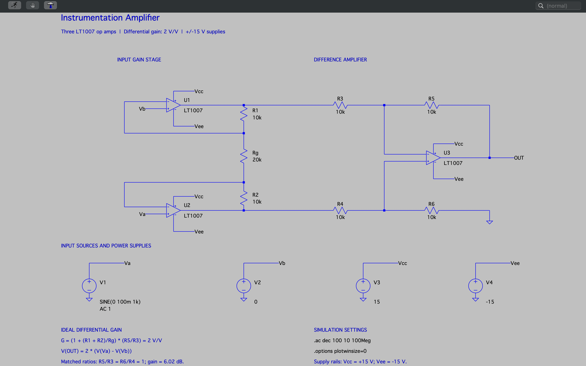
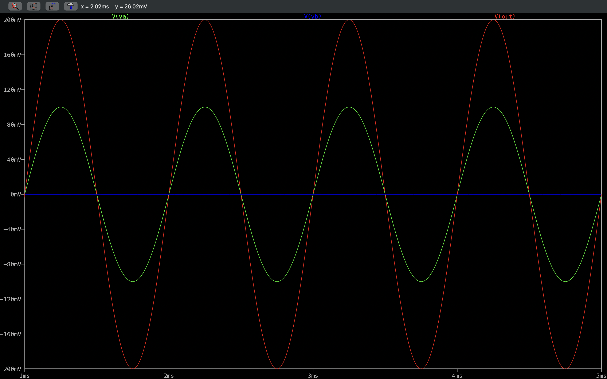
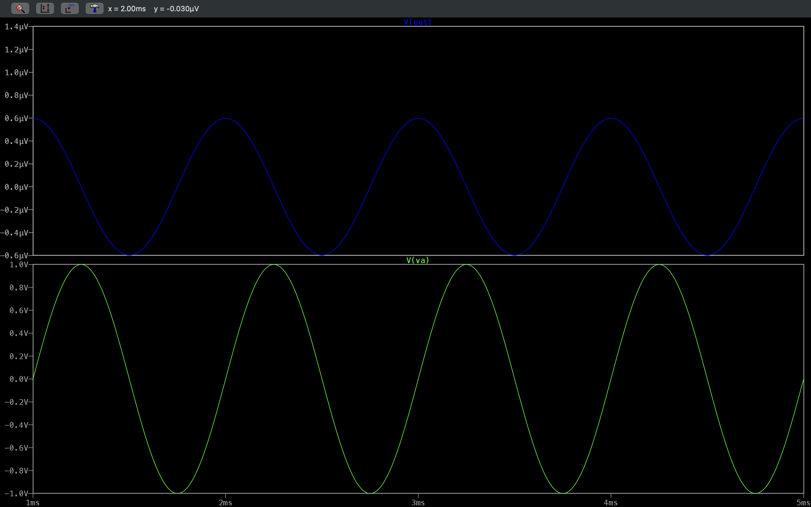
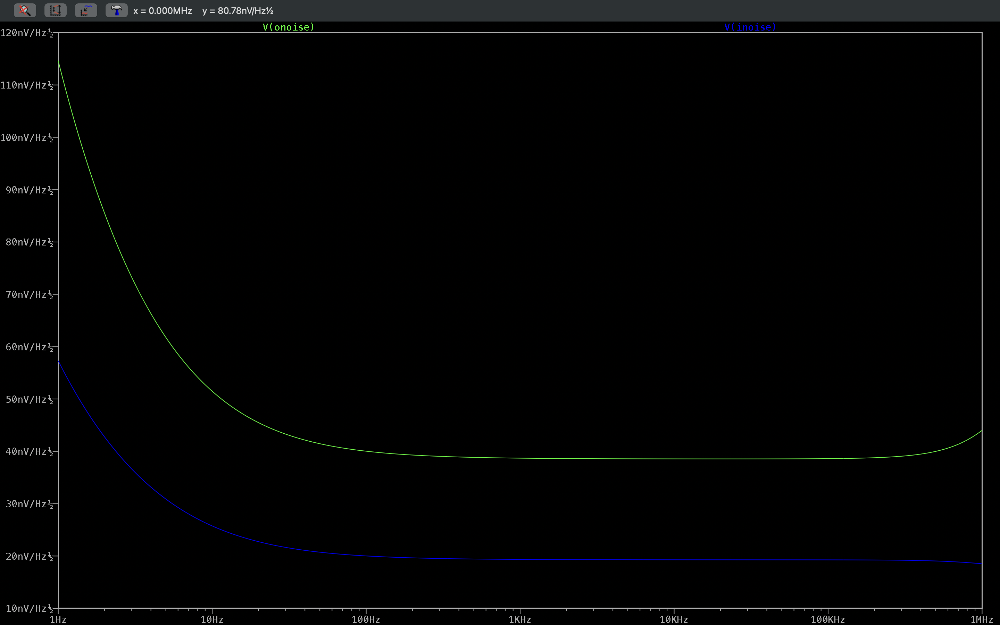

# Instrumentation Amplifier


This LTspice study models a classic three-op-amp instrumentation amplifier built from LT1007 macromodels, with an ideal differential gain of 2 V/V. The directory contains the native schematic, a schematic capture, and three saved captures: a 1 kHz differential transient response, a common-mode transient test, and output- and input-referred voltage-noise spectral densities.

The engineering question is how well the topology amplifies a differential signal while suppressing a signal common to both inputs, and what noise floor the op-amp and resistor models predict. The captures used different temporary source and analysis settings, so the saved source does not reproduce every capture without edits. Each condition is documented below.

## Table of Contents

- [Schematic](#schematic)
- [Simulation Plots](#simulation-plots)
- [Overview](#overview)
- [Specifications](#specifications)
- [Results](#results)
- [Simulation Setup](#simulation-setup)
- [Running the Simulation](#running-the-simulation)
- [Tech Stack](#tech-stack)
- [Tools and Environment](#tools-and-environment)
- [Repository Structure](#repository-structure)
- [References and Attribution](#references-and-attribution)
- [Contact](#contact)
- [License](#license)

## Schematic

[](Docs/Images/Schematics/Instrumentation_Amplifier_Schematic.png)

Native LTspice source: [Instrumentation_Amplifier_Simulation.asc](Simulation/LTspice_Files/Instrumentation_Amplifier_Simulation.asc)

> **Note:** The schematic image was captured from an annotated revision of the drawing. The saved `.asc` has the same components, values, net labels, and directives. Its comment text is older: the title reads "Instrumentation amplifier", and a gain note uses duplicate "blue" resistor aliases (R1/R2/R3). This README uses the actual instance names `R1`, `R2`, `Rg`, and `R3`-`R6`.

## Simulation Plots

### Differential Input and Output

[](Docs/Images/Plots/Instrumentation_Amplifier_Plot_Transient_Differential_Input_And_Output_Voltages_1_Kilohertz_Signal_Response.png)

*Transient, 1-5 ms. `V(va)` is a 100 mV-peak 1 kHz sine, `V(vb)` is held at 0 V, and `V(out)` is an in-phase sine of about 200 mV peak (400 mV peak-to-peak). This agrees with the ideal gain of 2 V/V.*

### Common-Mode Test

[](Docs/Images/Plots/Instrumentation_Amplifier_Plot_Transient_Output_Voltage_Common_Mode_Rejection_Test.png)

*Transient common-mode test, 1-5 ms. The lower pane shows `V(va)`, a 1 V-peak 1 kHz sine. The upper pane shows the output residual `V(out)`, about ±0.6 µV peak, which reaches its peaks near the input zero crossings. The capture does not display `V(vb)`, so the image alone does not show that `Vb` carried the identical signal. That setting was a temporary change from the saved source.*

### Noise Spectral Density

[](Docs/Images/Plots/Instrumentation_Amplifier_Plot_Noise_Input_And_Output_Referred_Voltage_Noise_Densities_Frequency_Response.png)

*`.noise` analysis, 1 Hz-1 MHz, in nV/√Hz. `V(onoise)` (output-referred) is about 39 nV/√Hz across the mid-band and rises toward about 115 nV/√Hz at 1 Hz (1/f region). `V(inoise)` (input-referred) is about 19-20 nV/√Hz mid-band and about 57 nV/√Hz at 1 Hz. These are spectral densities, not integrated RMS noise.*

A forward-gain AC plot (`V(OUT)/V(Va,Vb)`) is not included. The only saved AC capture plotted the reciprocal ratio, so it was withdrawn from the documentation. See [Simulation Setup](#simulation-setup) for how to produce the correct plot.

## Overview

| Section | Description |
| --- | --- |
| Input amplifiers | `U2` (non-inverting input on `Va`) and `U1` (non-inverting input on `Vb`) are LT1007 op amps configured as non-inverting buffers with gain. |
| Gain network | `R1` (10 kΩ) and `R2` (10 kΩ) are the feedback resistors of `U1` and `U2`. `Rg` (20 kΩ) connects their inverting inputs and sets the first-stage differential gain 1 + (R1 + R2)/Rg = 2. |
| Difference stage | `U3` with `R3`/`R5` (inverting path from `U1`) and `R4`/`R6` (non-inverting divider from `U2` to ground), all 10 kΩ, giving unity differential gain with matched ratios. |
| Supplies | `V3` = +15 V on `Vcc` and `V4` = −15 V on `Vee` power all three op amps. |
| Signal sources | `V1` drives `Va` with `SINE(0 100m 1k)` and `AC 1`. `V2` holds `Vb` at 0 V. |
| Analyses | The saved file runs `.ac dec 100 10 100Meg`. The transient, common-mode, and noise captures used temporary directives (see below). |

## Specifications

| Parameter | Value | Basis |
| --- | --- | --- |
| Op amps | 3 × LT1007 | Configured (LTspice library macromodel) |
| Supply rails | +15 V / −15 V | Configured (`V3`, `V4`) |
| R1, R2 | 10 kΩ each | Configured |
| Rg | 20 kΩ | Configured |
| R3, R4, R5, R6 | 10 kΩ each | Configured |
| Ideal differential gain | 2 V/V (≈ 6.02 dB) | Calculated: (1 + (R1 + R2)/Rg) × (R5/R3) |
| Ideal output relation | V(OUT) = 2 × (V(Va) − V(Vb)) | Calculated |
| Differential test input | 100 mV peak, 1 kHz on `Va`; `Vb` = 0 V | Configured (`V1`, `V2`) |
| Ideal output for that input | 200 mV peak (400 mV peak-to-peak) | Calculated |
| AC small-signal stimulus | 1 V on `Va` | Configured (`AC 1`) |
| AC sweep | 10 Hz-100 MHz, 100 points/decade | Configured (`.ac dec 100 10 100Meg`) |

The 6.02 dB gain is a nominal value calculated from the resistor ratios. It is not a newly simulated AC result.

## Results

| Quantity or Behavior | Result | Evidence | Interpretation |
| --- | --- | --- | --- |
| Differential gain at 1 kHz | Output ≈ 200 mV peak for a 100 mV-peak input, in phase | [Differential transient](Docs/Images/Plots/Instrumentation_Amplifier_Plot_Transient_Differential_Input_And_Output_Voltages_1_Kilohertz_Signal_Response.png) | Simulated observation, consistent with the ideal 2 V/V. Read from the plot axis, not a measured gain with stated precision. |
| Common-mode residual at 1 kHz | ≈ ±0.6 µV peak output for a 1 V-peak drive shown on `Va` | [Common-mode test](Docs/Images/Plots/Instrumentation_Amplifier_Plot_Transient_Output_Voltage_Common_Mode_Rejection_Test.png) | Simulated observation with perfectly matched resistors. If `Vb` carried the same 1 V signal (not shown in the capture), the residual is on the order of 10⁻⁶ of the input. This does not establish a hardware CMRR, which would be dominated by resistor mismatch. |
| Output-referred noise density | ≈ 39 nV/√Hz mid-band; ≈ 115 nV/√Hz at 1 Hz | [Noise density](Docs/Images/Plots/Instrumentation_Amplifier_Plot_Noise_Input_And_Output_Referred_Voltage_Noise_Densities_Frequency_Response.png) | Simulated spectral density from the models. No integration bandwidth or RMS total was computed. |
| Input-referred noise density | ≈ 19-20 nV/√Hz mid-band; ≈ 57 nV/√Hz at 1 Hz | Same plot | About half the output-referred density, consistent with the gain of 2. |
| Forward-gain frequency response | Not established | - | No valid `V(OUT)/V(Va,Vb)` capture exists in the repository. Bandwidth is not reported. |

**Modeling assumptions and scope.** The resistors are ideal and exactly matched, and the op amps are vendor macromodels. The results show model behavior and do not establish physical CMRR, offset, drift, or noise of a built circuit.

## Simulation Setup

Active directives in `Instrumentation_Amplifier_Simulation.asc`:

```spice
.ac dec 100 10 100Meg
.options plotwinsize=0
```

- Named nodes: `Va` and `Vb` (inputs), `OUT` (output), `Vcc` and `Vee` (supply rails).
- Forward differential gain trace for the AC analysis:
  ```text
  V(OUT)/V(Va,Vb)
  ```
  The reciprocal `V(Va,Vb)/V(OUT)` is the inverse of the gain and must not be used as the frequency response.
- The transient and noise captures required temporary changes. The saved file is left unchanged, and the exact historical directives were not recorded. For example, analyses that would cover the plotted spans are:
  ```spice
  .tran 5m
  .noise V(OUT) V1 dec 100 1 1Meg
  ```
  Replace `.ac` with one of these (only one primary analysis runs at a time).

## Running the Simulation

1. Obtain this repository and open `Simulation/LTspice_Files/Instrumentation_Amplifier_Simulation.asc` in LTspice.
2. Dependencies: the `LT1007` symbol and macromodel ship with the LTspice library. No local model files are required.
3. **AC differential gain (saved configuration):** Run the file as saved and plot `V(OUT)/V(Va,Vb)`. At low frequency the magnitude should be near the nominal 6.02 dB. This plot was not captured for this repository.
4. **Differential transient:** Temporarily replace `.ac` with a transient directive such as `.tran 5m`, run, and plot `V(Va)`, `V(Vb)`, and `V(OUT)` over 1-5 ms.
5. **Common-mode transient:** Temporarily set both `V1` and `V2` to the same source, for example `SINE(0 1 1k)`, run a transient, and plot `V(Va)`, `V(Vb)`, and `V(OUT)`. Keep the output on its own pane so the µV-scale residual is visible.
6. **Noise:** Temporarily use a `.noise V(OUT) V1 ...` directive over 1 Hz-1 MHz and plot `V(onoise)` and `V(inoise)`.
7. Revert the temporary edits, or save them under a different file name, so the canonical source stays unchanged.

## Tech Stack

| Category | Technology |
| --- | --- |
| Circuit Simulation |  |
| Version Control |  |
| Hosting |  |

## Tools and Environment

| Tool | Details |
| --- | --- |
| Simulator | LTspice. LTspice 17.2.4 is installed in the documentation environment; the version used for the original captures was not recorded. |
| Operating system | macOS |
| Device models | LT1007 op-amp macromodel from the LTspice library |

## Repository Structure

```text
Instrumentation_Amplifier/
├── Docs/
│   └── Images/
│       ├── Plots/
│       │   ├── Instrumentation_Amplifier_Plot_Noise_Input_And_Output_Referred_Voltage_Noise_Densities_Frequency_Response.png   # V(onoise), V(inoise)
│       │   ├── Instrumentation_Amplifier_Plot_Transient_Differential_Input_And_Output_Voltages_1_Kilohertz_Signal_Response.png  # Differential transient
│       │   └── Instrumentation_Amplifier_Plot_Transient_Output_Voltage_Common_Mode_Rejection_Test.png                          # Common-mode test
│       └── Schematics/
│           └── Instrumentation_Amplifier_Schematic.png        # Schematic capture
├── Simulation/
│   └── LTspice_Files/
│       └── Instrumentation_Amplifier_Simulation.asc           # Native LTspice schematic
└── README.md
```

## References and Attribution

- This study was selected from an existing collection of LTspice example circuits and then used by James Collier for simulation, waveform inspection, schematic annotation, and documentation. The three-op-amp instrumentation amplifier is a textbook topology and is not presented as an original invention.
- No upstream source credit, license, or URL is recorded in the local source file.
- The LT1007 macromodel is supplied with LTspice by Analog Devices and remains subject to its terms.

## Contact

- GitHub: [@devjamescollier](https://github.com/devjamescollier)
- Email: [jwcollie@usc.edu](mailto:jwcollie@usc.edu)

## License

No repository-wide license is declared. Original circuit sources and third-party models remain subject to their respective terms.
