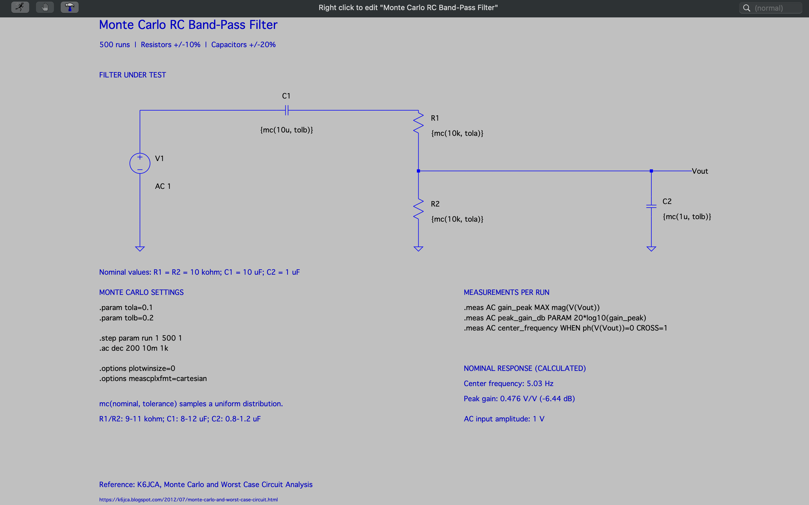
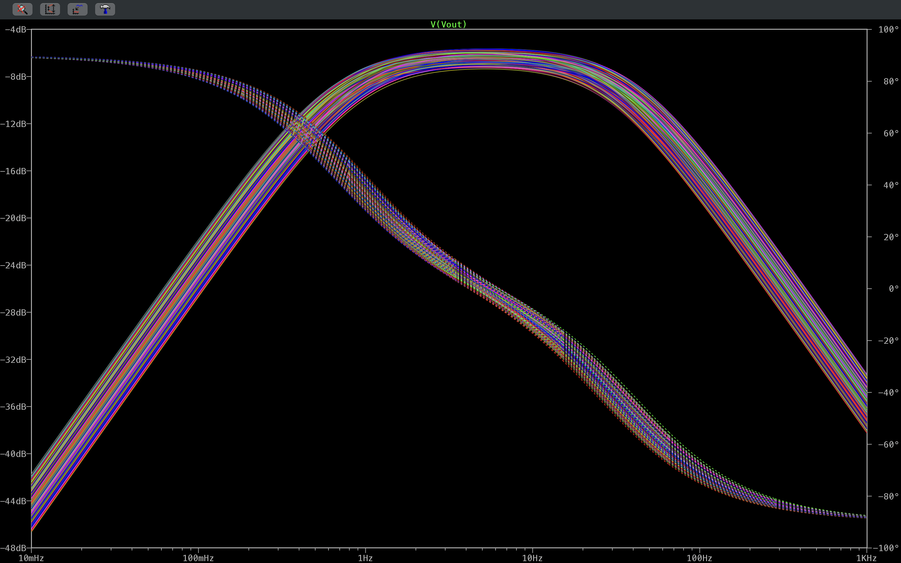
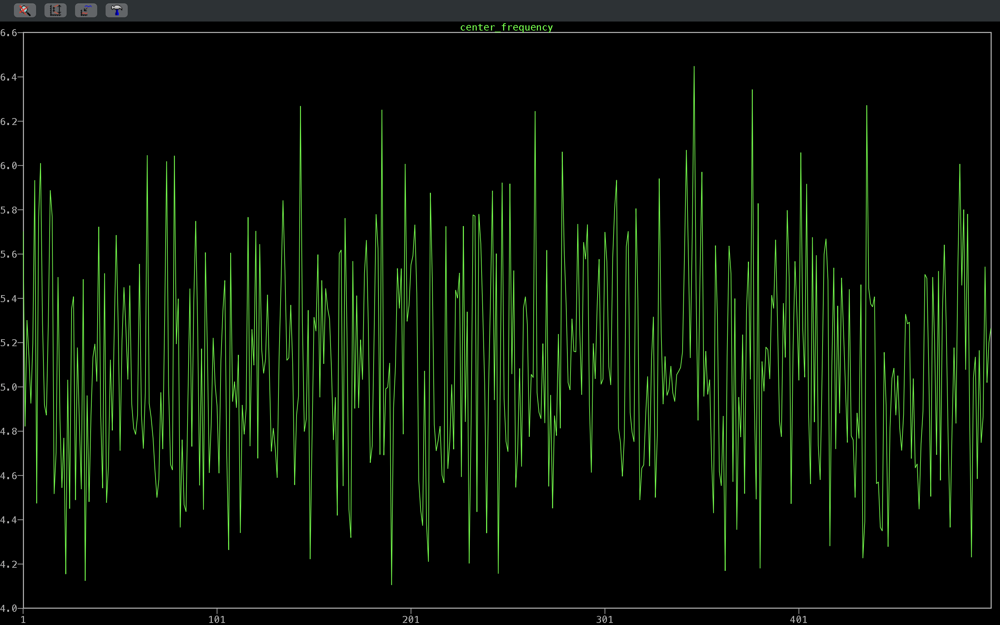
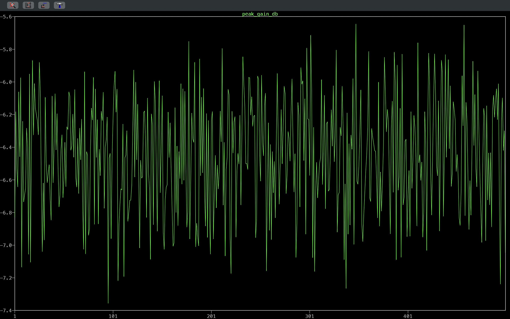

# Monte Carlo RC Band-Pass Filter

[](../LICENSE)
[](https://www.analog.com/en/resources/design-tools-and-calculators/ltspice-simulator.html)


Passive second-order RC band-pass filter analysed over 500 Monte Carlo runs. Each run draws new resistor values within ±10% and new capacitor values within ±20% from a uniform distribution, sweeps the AC response, and measures the filter's center frequency and peak gain with `.meas`.

Designed to show how component tolerances spread a filter's response, and to compare the statistical spread from Monte Carlo sampling against the nominal design and the worst-case bounds.

## Table of Contents
- [Schematic](#schematic)
- [Plots](#plots)
- [Overview](#overview)
- [Specifications](#specifications)
- [Results](#results)
- [Software](#software)
- [Tech Stack](#tech-stack)
- [Repository Structure](#repository-structure)
- [Contact](#contact)
- [License](#license)

## Schematic


## Plots

### Frequency Response, 500 Runs
Magnitude (solid, left axis) and phase (dashed, right axis) of V(Vout) for all 500 runs, 10 mHz to 1 kHz.



### Measured Center Frequency and Peak Gain per Run
| Center Frequency (Hz) | Peak Gain (dB) |
| :---: | :---: |
|  |  |

## Overview

The filter is a series high-pass section followed by a shunt low-pass section. C1 and R1 are in series from the source to the output, and R2 and C2 are in parallel from the output to ground.

| Section                  | Description |
| ------------------------ | ----------- |
| **Filter Under Test**    | C1 = 10 µF and R1 = 10 kΩ in series; R2 = 10 kΩ and C2 = 1 µF in shunt. Every value is written as `{mc(nominal, tolerance)}`. |
| **Monte Carlo Sampling** | `mc(x, y)` returns a value drawn uniformly between x·(1 − y) and x·(1 + y). `tola = 0.1` sets the resistors to 9–11 kΩ; `tolb = 0.2` sets C1 to 8–12 µF and C2 to 0.8–1.2 µF. |
| **Run Control**          | `.step param run 1 500 1` repeats the AC sweep 500 times, drawing new values each time. |
| **Measurements**         | `gain_peak` (maximum of \|V(Vout)\|), `peak_gain_db` (20·log₁₀ of gain_peak), and `center_frequency` (the frequency where the phase of V(Vout) crosses 0°). |

### Transfer Function

`H(s) = s·R2·C1 / (s²·R1·R2·C1·C2 + s·(R1·C1 + R2·C1 + R2·C2) + 1)`

At low frequency C1 blocks the signal and the phase is +90°. At high frequency C2 shorts the output and the phase is −90°. The phase crosses 0° at the same frequency where the magnitude peaks, so the two measurements describe the same point.

| Quantity | Formula | Nominal Value |
| --- | --- | --- |
| **Center frequency** | f<sub>0</sub> = 1 / (2π√(R1·R2·C1·C2)) | 5.03 Hz |
| **Peak gain** | 1 / (1 + R1/R2 + C2/C1) | 0.476 V/V (−6.44 dB) |
| **Quality factor** | Q = √(R1·R2·C1·C2) / (R1·C1 + R2·C1 + R2·C2) | 0.151 |
| **−3 dB band** | f<sub>L</sub>, f<sub>H</sub> | ≈ 0.74 Hz to ≈ 34 Hz |

### Worst-Case Bounds

Taking every component at its tolerance limit in the direction that moves each quantity furthest:

| Quantity | Minimum | Nominal | Maximum |
| --- | --- | --- | --- |
| **Center frequency** | 3.81 Hz | 5.03 Hz | 6.99 Hz |
| **Peak gain** | −7.50 dB | −6.44 dB | −5.50 dB |

## Specifications

| Parameter                  | Value |
| -------------------------- | ----- |
| **Topology**               | Passive second-order RC band-pass |
| **Nominal Components**     | R1 = R2 = 10 kΩ, C1 = 10 µF, C2 = 1 µF |
| **Resistor Tolerance**     | ±10% uniform (`tola = 0.1`) |
| **Capacitor Tolerance**    | ±20% uniform (`tolb = 0.2`) |
| **Monte Carlo Runs**       | 500 |
| **AC Sweep**               | `.ac dec 200 10m 1k` (200 points per decade, 10 mHz–1 kHz) |
| **Source**                 | 1 V AC |
| **Measurements**           | Peak gain (dB), center frequency (Hz) |

## Results

Values read from the LTspice `.meas` plots across all 500 runs:

| Measurement              | Nominal    | Monte Carlo Range     | Worst-Case Range      | Notes |
| -----------------------: | ---------: | --------------------: | --------------------: | ----: |
| **Center frequency**     | 5.03 Hz    | ≈ 4.1 to 6.45 Hz      | 3.81 to 6.99 Hz       | ≈ −18% / +28% from nominal |
| **Peak gain**            | −6.44 dB   | ≈ −7.36 to −5.65 dB   | −7.50 to −5.50 dB     | ≈ 1.7 dB spread |
| **Low-frequency phase**  | +90°       | ≈ +88° at 10 mHz      | —                     | All runs |
| **High-frequency phase** | −90°       | ≈ −88° at 1 kHz       | —                     | All runs |

### Discussion

**Center frequency.** The center frequency depends on all four components through √(R1·R2·C1·C2), so the ±20% capacitors dominate its spread. Across 500 runs it varied from ≈ 4.1 Hz to ≈ 6.45 Hz around the 5.03 Hz nominal. The spread is skewed upward (+28% against −18%) because f<sub>0</sub> depends on 1/√(product): a component at −20% moves f<sub>0</sub> further than one at +20%.

**Peak gain.** The peak gain depends only on the ratios R1/R2 and C2/C1, not on absolute values, so it is far less sensitive than the center frequency: the full spread is ≈ 1.7 dB. The resistor ratio R1/R2 has the most effect because it adds directly to the denominator, while the capacitor ratio is scaled down by the 10:1 nominal ratio of C1 to C2.

**Monte Carlo against worst case.** Every Monte Carlo result falls inside the worst-case bounds, but none reaches them. A worst-case corner needs all four components at their limits in the right direction at once, which is very unlikely with independent uniform draws. Summing four uniform variables (in log terms) pushes the distribution toward the center, so the 500-run spread covers about 75% of the worst-case frequency range. This is the main reason to use Monte Carlo: worst-case analysis gives a guaranteed bound, while Monte Carlo shows what a production run would actually look like.

**Frequency-response envelope.** The magnitude curves spread most on the slopes, where the response depends on one corner (C1 on the low side, C2 on the high side) and a ±20% capacitor shifts the curve by ±20% in frequency. Near the peak the curves bunch together, matching the small peak-gain spread. The phase curves stay within a narrow band and all cross 0° near the passband center.

**Design implications.** Because Q ≈ 0.15, this filter is a broad band-pass with a 0.74–34 Hz passband rather than a selective one, and its center frequency is the least repeatable parameter. Tighter capacitor tolerance gives the largest improvement: changing C1 and C2 from ±20% to ±5% roughly halves the center-frequency spread, while tighter resistors mainly improve the gain spread.

### Reference

The Monte Carlo method follows K6JCA, [Monte Carlo and Worst Case Circuit Analysis](https://k6jca.blogspot.com/2012/07/monte-carlo-and-worst-case-circuit.html).

### Limitations

- `mc()` draws from a uniform distribution. Real component values are usually closer to a truncated normal distribution, which would narrow the spread further.
- Temperature coefficients, aging, and parasitic effects are not modelled.
- The source is ideal and the output is unloaded; any load on V<sub>out</sub> would shift both the gain and the center frequency.

## Software

### Running

1. Install LTspice (tested with 17.2.4).
2. Open [`Simulation/LTspice_Files/Monte_Carlo_RC_Band_Pass_Filter_Simulation.asc`](Simulation/LTspice_Files/Monte_Carlo_RC_Band_Pass_Filter_Simulation.asc).
3. Run the simulation; the `.param`, `.step`, `.ac`, and `.meas` directives are on the schematic. The 500 runs complete in a few seconds.
4. Plot V(Vout) to reproduce the 500-run frequency response.
5. Open **View → SPICE Error Log**, right-click, and select **Plot .step'ed .meas data** to plot `center_frequency` and `peak_gain_db` against the run number.
6. Change `tola` and `tolb` to compare other tolerance grades.

## Tech Stack

| Circuit Simulation | Version Control | Repository Hosting |
| :----------------: | :-------------: | :----------------: |
|  |  |  |

## Repository Structure

```text
Monte_Carlo_RC_Band_Pass_Filter
├── Docs                                                                           Contains simulation images
│   └── Images
│       ├── Plots                                                                  Contains exported AC and .meas plots
│       │   ├── Monte_Carlo_RC_Band_Pass_Filter_Plot_AC_Output_Gain_And_Phase_500_Run_Monte_Carlo_Frequency_Response.png
│       │   │                                                                      Magnitude and phase for all 500 runs
│       │   ├── Monte_Carlo_RC_Band_Pass_Filter_Plot_Monte_Carlo_Center_Frequency_In_Hertz_Versus_Simulation_Run.png
│       │   │                                                                      Center frequency for each run
│       │   └── Monte_Carlo_RC_Band_Pass_Filter_Plot_Monte_Carlo_Peak_Gain_In_Decibels_Versus_Simulation_Run.png
│       │                                                                          Peak gain for each run
│       └── Schematics                                                             Contains the schematic image
│           └── Monte_Carlo_RC_Band_Pass_Filter_Schematic.png                      Schematic in PNG format
├── Simulation
│   └── LTspice_Files
│       └── Monte_Carlo_RC_Band_Pass_Filter_Simulation.asc                         LTspice schematic and simulation file
└── README.md                                                                      Simulation README
```

## Contact
- GitHub: [@devjamescollier](https://github.com/devjamescollier)
- Email: [jwcollie@usc.edu](mailto:jwcollie@usc.edu)

## License

Copyright © 2026 James Collier

This project is licensed under the MIT License. See [LICENSE](../LICENSE).
