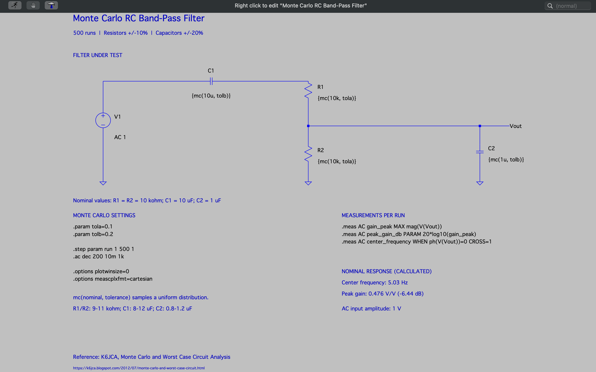
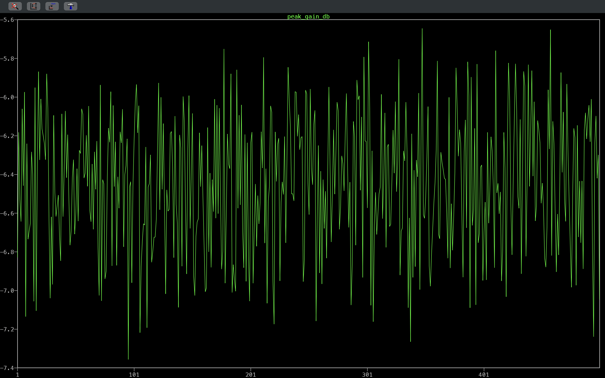
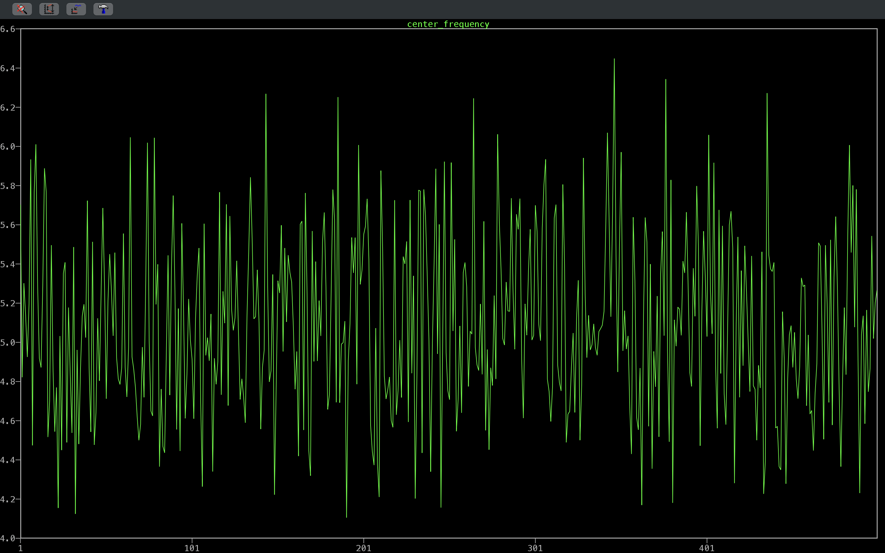

# Monte Carlo RC Band-Pass Filter


This LTspice study runs a 500-case Monte Carlo AC analysis of a loaded passive RC band-pass filter. Each resistor and capacitor value is randomized within its tolerance on every run. The directory contains the native schematic, a schematic capture, an overlaid Bode plot of all 500 runs, and two plots of per-run `.meas` results: peak gain and center frequency versus run index.

The engineering question is how sensitive the filter's peak gain and center frequency are to component tolerance. The study compares the nominal design equations with the spread produced by uniformly distributed ±10% resistors and ±20% capacitors.

## Table of Contents

- [Schematic](#schematic)
- [Simulation Plots](#simulation-plots)
- [Overview](#overview)
- [Specifications](#specifications)
- [Results](#results)
- [Simulation Setup](#simulation-setup)
- [Running the Simulation](#running-the-simulation)
- [Tech Stack](#tech-stack)
- [Tools and Environment](#tools-and-environment)
- [Repository Structure](#repository-structure)
- [References and Attribution](#references-and-attribution)
- [Contact](#contact)
- [License](#license)

## Schematic

[](Docs/Images/Schematics/Monte_Carlo_RC_Band_Pass_Filter_Schematic.png)

Native LTspice source: [Monte_Carlo_RC_Band_Pass_Filter_Simulation.asc](Simulation/LTspice_Files/Monte_Carlo_RC_Band_Pass_Filter_Simulation.asc)

> **Note:** The schematic image was captured from an annotated revision of the drawing. The saved `.asc` has the same components, values, and directives. Its comment text is older: it is titled "Monte Carlo analysis in LTSpiceIV" and does not contain the K6JCA reference line shown in the image. That credit is preserved under [References and Attribution](#references-and-attribution).

## Simulation Plots

### Overlaid Frequency Response (500 Runs)

[](Docs/Images/Plots/Monte_Carlo_RC_Band_Pass_Filter_Plot_AC_Output_Gain_And_Phase_500_Run_Monte_Carlo_Frequency_Response.png)

*AC analysis of `V(Vout)`, 10 mHz-1 kHz. Solid traces are gain in dB (left axis) and dashed traces are phase in degrees (right axis), for all 500 runs overlaid. The pass-band peaks fall between about −5.6 dB and −7.4 dB, centered near 5 Hz. Phase moves from about +90° at low frequency to about −90° at high frequency and crosses 0° near the peak.*

### Peak Gain Versus Run

[](Docs/Images/Plots/Monte_Carlo_RC_Band_Pass_Filter_Plot_Monte_Carlo_Peak_Gain_In_Decibels_Versus_Simulation_Run.png)

*The `.meas` result `peak_gain_db` (dB) for each run, plotted against run index 1-500. Values range from about −7.4 dB to −5.6 dB. This is a run-index plot, not a histogram or probability distribution.*

### Center Frequency Versus Run

[](Docs/Images/Plots/Monte_Carlo_RC_Band_Pass_Filter_Plot_Monte_Carlo_Center_Frequency_In_Hertz_Versus_Simulation_Run.png)

*The `.meas` result `center_frequency` (Hz, the 0° phase crossing) for each run, plotted against run index 1-500. Values range from about 4.1 Hz to 6.4 Hz. This is a run-index plot, not a histogram.*

## Overview

| Section | Description |
| --- | --- |
| Source | `V1` supplies a 1 V AC small-signal stimulus. |
| Series high-pass element | `C1` = `{mc(10u, tolb)}` couples the source to the top of `R1`. |
| Series resistor | `R1` = `{mc(10k, tola)}` connects to the output node `Vout`. |
| Shunt load | `R2` = `{mc(10k, tola)}` and `C2` = `{mc(1u, tolb)}` connect `Vout` to ground, which sets the low-pass roll-off and loads the network. |
| Randomization | `mc(x, y)` returns a value uniformly distributed between x(1 − y) and x(1 + y), re-drawn on every step. |
| Stepping | `.step param run 1 500 1` repeats the AC analysis 500 times. |
| Measurements | Each run records `gain_peak`, `peak_gain_db`, and `center_frequency` with `.meas AC`. |

Nominal transfer function, from the topology above:

```text
H(s) = s*R2*C1 / [1 + s*(R1*C1 + R2*C1 + R2*C2) + s^2*R1*R2*C1*C2]
```

## Specifications

| Parameter | Value | Basis |
| --- | --- | --- |
| AC stimulus | 1 V | Configured (`V1`, `AC 1`) |
| R1, R2 nominal / range | 10 kΩ / 9-11 kΩ (±10%, uniform) | Configured (`tola = 0.1`) |
| C1 nominal / range | 10 µF / 8-12 µF (±20%, uniform) | Configured (`tolb = 0.2`) |
| C2 nominal / range | 1 µF / 0.8-1.2 µF (±20%, uniform) | Configured (`tolb = 0.2`) |
| Number of runs | 500 | Configured (`.step param run 1 500 1`) |
| AC sweep | 0.01 Hz-1 kHz, 200 points/decade | Configured (`.ac dec 200 10m 1k`; `10m` means 0.01 Hz, not 10 MHz) |
| Nominal center frequency | ≈ 5.0329 Hz | Calculated: 1 / (2π√(R1·R2·C1·C2)) |
| Nominal peak gain | ≈ 0.47619 V/V (≈ −6.4444 dB) | Calculated: R2·C1 / (R1·C1 + R2·C1 + R2·C2) |

The nominal values come from the design equations at nominal component values. They are not the minimum, mean, or maximum of the random sample.

## Results

| Quantity or Behavior | Result | Evidence | Interpretation |
| --- | --- | --- | --- |
| Peak gain spread | −7.356 dB (run 96) to −5.645 dB (run 348) | [Peak gain plot](Docs/Images/Plots/Monte_Carlo_RC_Band_Pass_Filter_Plot_Monte_Carlo_Peak_Gain_In_Decibels_Versus_Simulation_Run.png) and the generated `.meas` log | Simulated observation for this particular 500-run sample. The plot axis and the log agree. |
| Center frequency spread | 4.106 Hz (run 191) to 6.448 Hz (run 347) | [Center frequency plot](Docs/Images/Plots/Monte_Carlo_RC_Band_Pass_Filter_Plot_Monte_Carlo_Center_Frequency_In_Hertz_Versus_Simulation_Run.png) and the generated `.meas` log | Simulated observation. The spread is roughly −18% / +28% around the 5.03 Hz nominal. |
| Sample mean of the measurements | Peak gain ≈ 0.4765 V/V (≈ −6.45 dB average of dB values); center frequency ≈ 5.09 Hz | Computed from all 500 rows of the generated `.meas` log | Sample statistics for this one random sample, close to the nominal calculations. They are not a statistical guarantee, and no confidence interval is implied. |
| Response shape | Second-order band-pass: +20 dB/decade below the peak and −20 dB/decade above it, phase +90° to −90° | [Overlaid Bode plot](Docs/Images/Plots/Monte_Carlo_RC_Band_Pass_Filter_Plot_AC_Output_Gain_And_Phase_500_Run_Monte_Carlo_Frequency_Response.png) | Simulated observation, consistent with H(s). |

The `.meas` log (`.log.raw`) was generated by LTspice with these captures and is kept locally but not tracked in Git. Re-running the file produces new random values, because no random seed is configured. No yield, pass/fail limit, or distribution shape is claimed. The component draws are uniform, and the resulting gain and frequency spreads have not been fitted to any distribution.

## Simulation Setup

Directive block in `Monte_Carlo_RC_Band_Pass_Filter_Simulation.asc`:

```spice
.param tola=0.1
.param tolb=0.2
.step param run 1 500 1
.ac dec 200 10m 1k
.options plotwinsize=0
.options meascplxfmt=cartesian
.meas AC gain_peak MAX mag(V(Vout))
.meas AC peak_gain_db PARAM 20*log10(gain_peak)
.meas AC center_frequency WHEN ph(V(Vout))=0 CROSS=1
```

- `run` is a dummy parameter. Stepping it forces LTspice to re-evaluate every `mc()` call on each pass.
- `gain_peak` is the maximum magnitude of `V(Vout)`. `peak_gain_db` converts it to dB. `center_frequency` is the frequency of the first 0° phase crossing, which for this network coincides with the peak.

## Running the Simulation

1. Obtain this repository and open `Simulation/LTspice_Files/Monte_Carlo_RC_Band_Pass_Filter_Simulation.asc` in LTspice.
2. Dependencies: none. All components are LTspice primitives.
3. Run the analysis. All 500 steps execute in sequence.
4. Plot `V(Vout)` to see the overlaid gain (dB) and phase for all runs.
5. Open the SPICE error log (**View → SPICE Error Log**) to read the `.meas` results for each step. To plot a measurement against run index, right-click in the log and choose **Plot .step'ed .meas data**, then add `peak_gain_db` or `center_frequency`.

Results will differ from the saved captures in detail, because the random values are not seeded.

## Tech Stack

| Category | Technology |
| --- | --- |
| Circuit Simulation |  |
| Version Control |  |
| Hosting |  |

## Tools and Environment

| Tool | Details |
| --- | --- |
| Simulator | LTspice. The generated `.meas` log identifies "LTspice XVII". LTspice 17.2.4 is installed in the documentation environment. |
| Operating system | macOS |
| Device models | LTspice primitives only (R, C, voltage source) |

## Repository Structure

```text
Monte_Carlo_RC_Band_Pass_Filter/
├── Docs/
│   └── Images/
│       ├── Plots/
│       │   ├── Monte_Carlo_RC_Band_Pass_Filter_Plot_AC_Output_Gain_And_Phase_500_Run_Monte_Carlo_Frequency_Response.png   # 500-run Bode overlay
│       │   ├── Monte_Carlo_RC_Band_Pass_Filter_Plot_Monte_Carlo_Center_Frequency_In_Hertz_Versus_Simulation_Run.png        # center_frequency vs run
│       │   └── Monte_Carlo_RC_Band_Pass_Filter_Plot_Monte_Carlo_Peak_Gain_In_Decibels_Versus_Simulation_Run.png            # peak_gain_db vs run
│       └── Schematics/
│           └── Monte_Carlo_RC_Band_Pass_Filter_Schematic.png        # Schematic capture
├── Simulation/
│   └── LTspice_Files/
│       └── Monte_Carlo_RC_Band_Pass_Filter_Simulation.asc           # Native LTspice schematic
└── README.md
```

## References and Attribution

- K6JCA, "Monte Carlo and Worst Case Circuit Analysis," credited on the schematic capture: <https://k6jca.blogspot.com/2012/07/monte-carlo-and-worst-case-circuit.html>
- This study was selected from an existing collection of LTspice example circuits that follows the K6JCA approach. James Collier then used it for simulation, measurement review, schematic annotation, and documentation. The filter and Monte Carlo method are not presented as original inventions.

## Contact

- GitHub: [@devjamescollier](https://github.com/devjamescollier)
- Email: [jwcollie@usc.edu](mailto:jwcollie@usc.edu)

## License

No repository-wide license is declared. Original circuit sources and third-party models remain subject to their respective terms.
