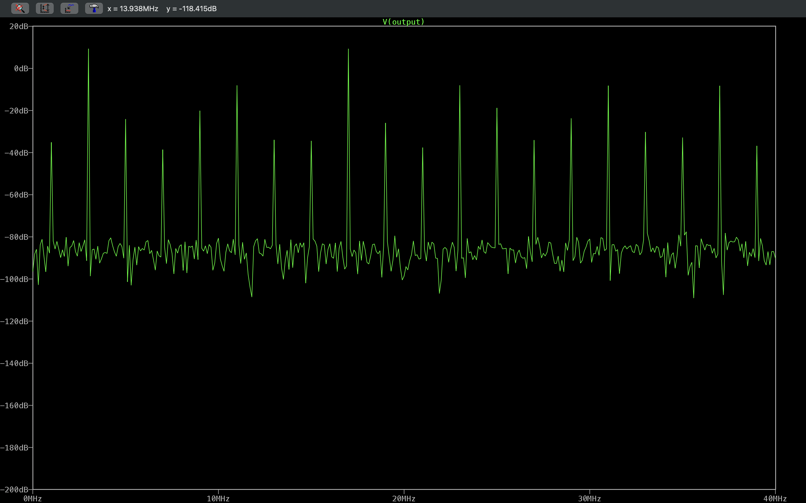
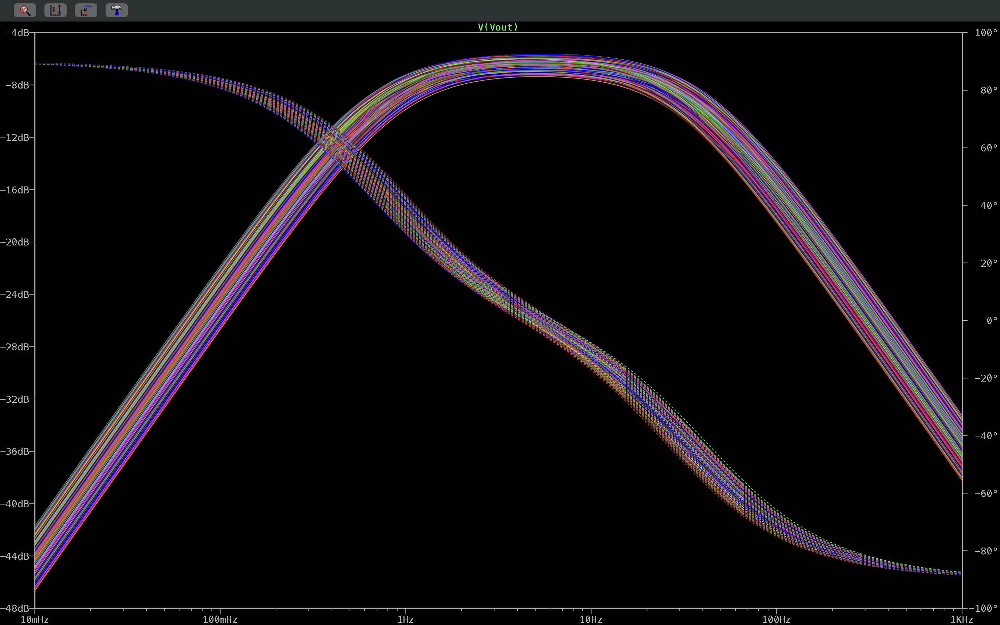

# LTspice Circuit Simulation Portfolio


This repository contains five documented LTspice simulation studies covering power conversion, analog signal conditioning, RF frequency translation, and component-tolerance analysis. Each project includes the native `.asc` schematic, a schematic capture, saved waveform or spectrum plots, and a README covering the configured parameters, calculated expectations, observations from the plots, and reproduction steps.

The circuits were selected from an existing collection of LTspice examples. James Collier then simulated them, inspected the waveforms, annotated the schematics, and wrote the documentation. The saved figures are simulation evidence. None of these circuits has been built or tested as physical hardware.

## Table of Contents

- [Projects](#projects)
- [Selected Figures](#selected-figures)
- [Getting Started](#getting-started)
- [Evidence and Scope](#evidence-and-scope)
- [Tech Stack](#tech-stack)
- [Tools and Environment](#tools-and-environment)
- [Repository Structure](#repository-structure)
- [Supporting Documentation](#supporting-documentation)
- [References and Attribution](#references-and-attribution)
- [Contact](#contact)
- [License](#license)

## Projects

| Project | Engineering Focus | Included Analyses | Documentation |
| --- | --- | --- | --- |
| Closed-Loop Buck Converter | 20 V to 10 V PWM buck with behavioral PI voltage control and a 1 Ω to 2 Ω load step | Transient startup and load step; steady-state switching-node zoom | [README](Closed_Loop_Buck_Converter/README.md) |
| Three-Phase Full-Bridge Inverter | 380 V DC link, 16 kHz sinusoidal PWM, 160 Hz output into star and delta RL loads | Transient star-load currents; phase-to-neutral, line-to-line, and PWM-control switching zooms | [README](Three_Phase_Full_Bridge_Inverter/README.md) |
| Instrumentation Amplifier | Three-op-amp LT1007 topology with an ideal gain of 2 V/V | Differential transient; common-mode transient; input- and output-referred noise density | [README](Instrumentation_Amplifier/README.md) |
| Monte Carlo RC Band-Pass Filter | Sensitivity of a passive band-pass filter to ±10% resistor and ±20% capacitor tolerances | 500-run AC sweep; per-run peak gain and center frequency | [README](Monte_Carlo_RC_Band_Pass_Filter/README.md) |
| Diode Ring Mixer | Frequency translation of a 10 MHz RF input by a 7 MHz LO through a Schottky diode ring | LO, RF, and output transients; output FFT over 0-40 MHz and 0-100 MHz | [README](Diode_Ring_Mixer/README.md) |

## Selected Figures

### Closed-Loop Buck Converter: Startup and Load Step

[](Closed_Loop_Buck_Converter/README.md)

*The output overshoots during startup, settles near the 10 V reference, and returns to it after the load current steps from about 10 A to about 5 A at 5 ms.*

### Diode Ring Mixer: Output Spectrum

[](Diode_Ring_Mixer/README.md)

*The strongest output lines fall at the 3 MHz difference and 17 MHz sum frequencies, with weaker higher-order products at other odd-MHz frequencies.*

### Monte Carlo RC Band-Pass Filter: 500-Run Frequency Response

[](Monte_Carlo_RC_Band_Pass_Filter/README.md)

*Component tolerances spread the peak gain over roughly −7.4 dB to −5.6 dB around a center frequency near 5 Hz.*

## Getting Started

Each project folder follows the same layout:

| Path | Contents |
| --- | --- |
| `<Project>/README.md` | Full write-up for that study |
| `<Project>/Simulation/LTspice_Files/<Project>_Simulation.asc` | Native LTspice schematic. Open it in LTspice to inspect or re-run the circuit. |
| `<Project>/Docs/Images/Schematics/<Project>_Schematic.png` | Schematic capture |
| `<Project>/Docs/Images/Plots/<Project>_Plot_<Analysis>_<Signal>_<View>.png` | Saved waveform, spectrum, or measurement plots |

To reproduce a study:

1. Install LTspice from Analog Devices.
2. Open the project's `.asc` file. All device models are from the standard LTspice library, and no custom libraries or symbols are required.
3. Run the analysis and add the traces listed in that project's **Running the Simulation** section.

Some captures, especially for the instrumentation amplifier, used temporary source or analysis settings. Those differences are documented in each README. No `.plt` plot-settings files were saved, so traces must be selected manually.

## Evidence and Scope

Each README separates four kinds of statement:

- **Configured:** values read directly from the `.asc` file (component values, sources, directives).
- **Calculated:** ideal or nominal values derived from equations and labeled as such.
- **Simulated observation:** behavior visible in a saved plot or recorded in an LTspice measurement log, stated approximately where it was read from a plot axis.
- **Not established:** quantities the existing evidence does not support. These are not reported, for example efficiency, phase margin, THD, bandwidth, or physical CMRR.

The figures were produced by circuit simulation with idealized elements such as behavioral sources, ideal switches, and ideal magnetic coupling. They do not show PCB layout, fabrication, or bench measurements.

## Tech Stack

| Category | Technology |
| --- | --- |
| Circuit Simulation |  |
| Version Control |  |
| Hosting |  |

## Tools and Environment

| Tool | Details |
| --- | --- |
| Simulator | LTspice. LTspice 17.2.4 is installed in the documentation environment; the version used for each original capture was not recorded. |
| Operating system | macOS |

## Repository Structure

```text
LTspice_Simulations/
├── Closed_Loop_Buck_Converter/
│   ├── Docs/Images/
│   │   ├── Plots/                 # 2 transient plots
│   │   └── Schematics/            # Schematic capture
│   ├── Simulation/LTspice_Files/  # Closed_Loop_Buck_Converter_Simulation.asc
│   └── README.md
├── Diode_Ring_Mixer/
│   ├── Docs/Images/
│   │   ├── Plots/                 # 3 transient plots, 2 FFT views
│   │   └── Schematics/
│   ├── Simulation/LTspice_Files/  # Diode_Ring_Mixer_Simulation.asc
│   └── README.md
├── Docs/
│   ├── File_Rename_Manifest.csv   # Original-to-final path and hash record
│   ├── Portfolio_Asset_Index.md   # Curated figure list with captions
│   └── Validation_Report.md       # Checks performed and open evidence gaps
├── Instrumentation_Amplifier/
│   ├── Docs/Images/
│   │   ├── Plots/                 # 2 transient plots, 1 noise-density plot
│   │   └── Schematics/
│   ├── Simulation/LTspice_Files/  # Instrumentation_Amplifier_Simulation.asc
│   └── README.md
├── Monte_Carlo_RC_Band_Pass_Filter/
│   ├── Docs/Images/
│   │   ├── Plots/                 # 500-run AC overlay, 2 per-run measurement plots
│   │   └── Schematics/
│   ├── Simulation/LTspice_Files/  # Monte_Carlo_RC_Band_Pass_Filter_Simulation.asc
│   └── README.md
├── Three_Phase_Full_Bridge_Inverter/
│   ├── Docs/Images/
│   │   ├── Plots/                 # 4 transient plots
│   │   └── Schematics/
│   ├── Simulation/LTspice_Files/  # Three_Phase_Full_Bridge_Inverter_Simulation.asc
│   └── README.md
├── .gitignore
└── README.md
```

## Supporting Documentation

- [File Rename Manifest](Docs/File_Rename_Manifest.csv): every original asset with its final path and SHA-256 hashes before and after the move.
- [Portfolio Asset Index](Docs/Portfolio_Asset_Index.md): curated schematic and plot list with short captions.
- [Validation Report](Docs/Validation_Report.md): inspection and link checks, preservation results, and remaining evidence gaps.

## References and Attribution

- The circuits were selected from an existing LTspice example-circuit collection (Circuits-LTSpice-Master). No upstream URL or license for that collection was found in the local files.
- The Monte Carlo study credits K6JCA, "Monte Carlo and Worst Case Circuit Analysis": <https://k6jca.blogspot.com/2012/07/monte-carlo-and-worst-case-circuit.html>
- Device models (BSB012N03LX3, 1N5819, LT1007) are supplied with LTspice by Analog Devices and remain subject to their terms.
- James Collier's contributions are the simulation runs, waveform and measurement review, schematic annotation, file organization, and documentation. The underlying topologies are standard circuits and are not presented as original inventions.

## Contact

- GitHub: [@devjamescollier](https://github.com/devjamescollier)
- Email: [jwcollie@usc.edu](mailto:jwcollie@usc.edu)

## License

No repository-wide license is declared. Original circuit sources and third-party models remain subject to their respective terms.
