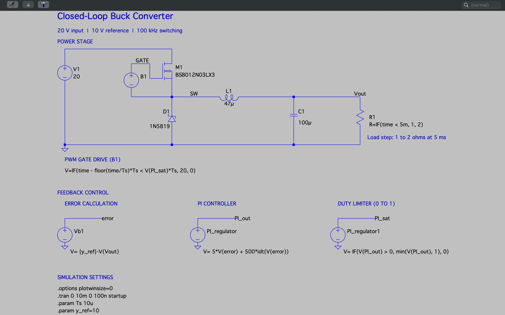
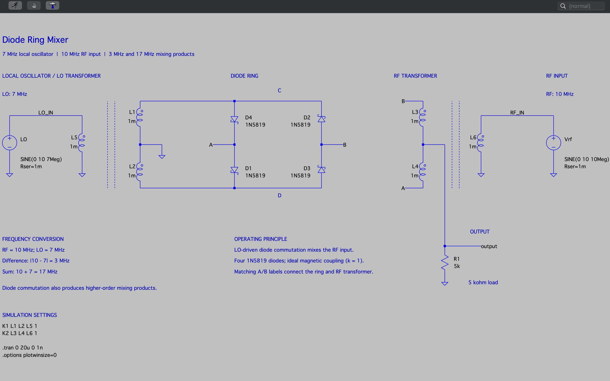
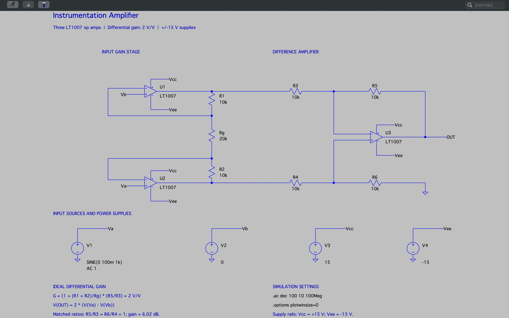
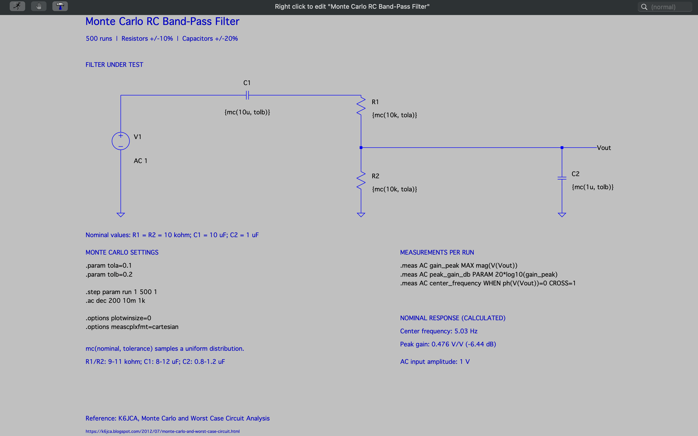
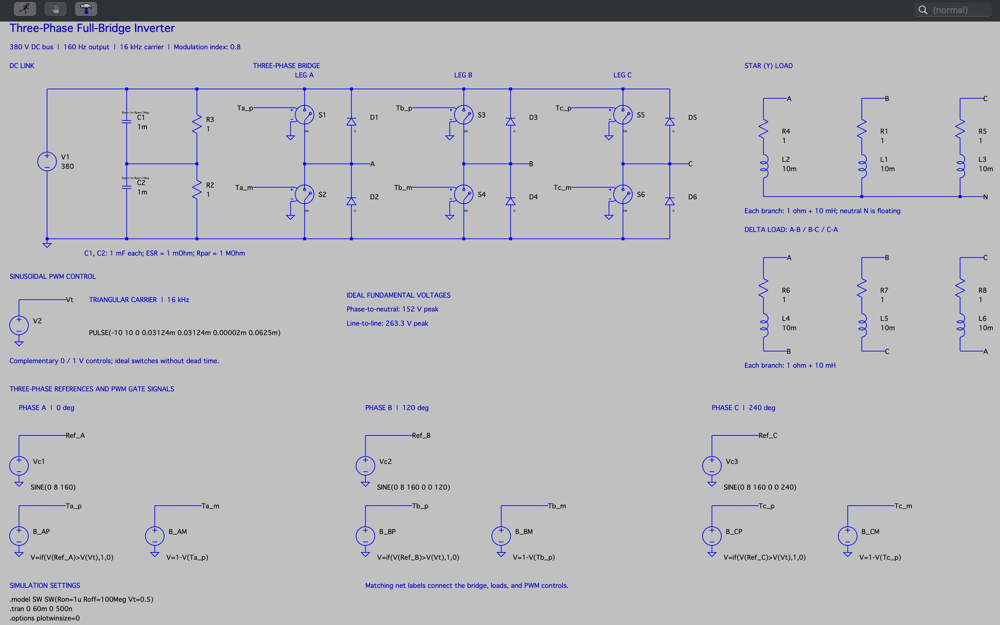

# LTspice Simulations

[](LICENSE)
[](https://www.analog.com/en/resources/design-tools-and-calculators/ltspice-simulator.html)


A collection of five LTspice circuit simulations covering power conversion, RF frequency translation, precision analog front-ends, and statistical tolerance analysis. Each simulation is a self-contained folder with its schematic, the LTspice source file, exported waveform plots, and a README that explains the circuit, the expected behaviour from hand analysis, and how the simulated results compare.

The circuits were chosen to exercise the main LTspice analysis types: transient, AC, noise, FFT, `.step` parameter sweeps, `.meas` measurements, behavioural sources, coupled inductors, and Monte Carlo tolerance sampling.

## Table of Contents
- [Simulations](#simulations)
- [Overview](#overview)
- [Results](#results)
- [Software](#software)
- [Tech Stack](#tech-stack)
- [Equipment](#equipment)
- [Repository Structure](#repository-structure)
- [Contact](#contact)
- [License](#license)

## Simulations

| Closed-Loop Buck Converter | Diode Ring Mixer |
| :---: | :---: |
| [](Closed_Loop_Buck_Converter/README.md) | [](Diode_Ring_Mixer/README.md) |
| **Instrumentation Amplifier** | **Monte Carlo RC Band-Pass Filter** |
| [](Instrumentation_Amplifier/README.md) | [](Monte_Carlo_RC_Band_Pass_Filter/README.md) |
| **Three-Phase Full-Bridge Inverter** | |
| [](Three_Phase_Full_Bridge_Inverter/README.md) | |

Click a schematic to open that simulation's README.

## Overview

| Simulation | Domain | Analyses | Description |
| --- | --- | --- | --- |
| **[Closed-Loop Buck Converter](Closed_Loop_Buck_Converter/README.md)** | Power electronics | Transient | 20 V to 10 V, 100 kHz non-synchronous buck with a behavioural PI voltage loop, a 0–1 duty limiter, and a 1 Ω to 2 Ω load step at 5 ms. |
| **[Diode Ring Mixer](Diode_Ring_Mixer/README.md)** | RF | Transient, FFT | Double-balanced mixer with four 1N5819 Schottky diodes and two center-tapped transformers, mixing a 7 MHz LO with a 10 MHz RF input into 3 MHz and 17 MHz products. |
| **[Instrumentation Amplifier](Instrumentation_Amplifier/README.md)** | Precision analog | Transient, AC, noise | Classic three-op-amp instrumentation amplifier built from LT1007s with a differential gain of 2 V/V, tested for gain, common-mode rejection, and noise density. |
| **[Monte Carlo RC Band-Pass Filter](Monte_Carlo_RC_Band_Pass_Filter/README.md)** | Tolerance analysis | AC, `.step`, `.meas` | Passive RC band-pass filter swept over 500 Monte Carlo runs with ±10% resistors and ±20% capacitors, measuring center frequency and peak gain per run. |
| **[Three-Phase Full-Bridge Inverter](Three_Phase_Full_Bridge_Inverter/README.md)** | Power electronics | Transient | 380 V DC-link, six-switch inverter driven by 16 kHz sinusoidal PWM (m = 0.8) into star and delta R-L loads at 160 Hz. |

## Results

Headline results from each simulation. Full tables, plots, and discussion are in each folder's README.

| Simulation | Quantity | Expected | Simulated | Notes |
| ---: | ---: | ---: | ---: | ---: |
| **Buck Converter** | Regulated output | 10.0 V | 10.0 V | Zero steady-state error from the PI integrator |
| **Buck Converter** | Duty cycle at 2 Ω | 0.52 | ≈ 0.51 | 5.1 µs on-time in a 10 µs period |
| **Buck Converter** | Startup overshoot | — | 14.1 V peak | Duty saturates at 1 during startup; no anti-windup |
| **Diode Ring Mixer** | IF products | 3 MHz, 17 MHz | 3 MHz, 17 MHz | Both ≈ +9 dBV, ≈ 11 dB conversion loss |
| **Diode Ring Mixer** | LO feedthrough | Suppressed | ≈ −38 dBV | ≈ 47 dB below the IF products |
| **Diode Ring Mixer** | RF feedthrough | Suppressed | Not visible | No component at 10 MHz above the noise floor |
| **Instrumentation Amp** | Differential gain | 2 V/V | 2.00 V/V | 100 mV in, 200 mV out, in phase |
| **Instrumentation Amp** | CMRR at 1 kHz | — | ≈ 130 dB | 1 V common mode gives 0.6 µV at the output |
| **Instrumentation Amp** | Input-referred noise | 18.7 nV/√Hz | ≈ 19.3 nV/√Hz | Dominated by resistor thermal noise |
| **RC Band-Pass Filter** | Nominal center frequency | 5.03 Hz | — | Spread 4.1–6.45 Hz over 500 runs |
| **RC Band-Pass Filter** | Nominal peak gain | −6.44 dB | — | Spread −7.36 to −5.65 dB over 500 runs |
| **Three-Phase Inverter** | Phase-to-neutral levels | 0, ±127, ±253 V | 0, ±127, ±253 V | ±V<sub>dc</sub>/3 and ±2V<sub>dc</sub>/3 |
| **Three-Phase Inverter** | Star-load phase current | 15.05 A peak | ≈ 15 A peak | Settles after the 10 ms L/R offset decays |

## Software

All simulations run in LTspice and use only the standard LTspice component library (LT1007, 1N5819, BSB012N03LX3, and generic passive, switch, and behavioural-source models).

### Running

1. Install LTspice (tested with 17.2.4).
2. Open the `.asc` file in any simulation's [`Simulation/LTspice_Files`](Closed_Loop_Buck_Converter/Simulation/LTspice_Files/) folder.
3. Run the simulation from the toolbar; the analysis directives are already on the schematic.
4. Probe the labelled nets, or follow the specific steps in that simulation's README to reproduce each plot.

LTspice output files (`.raw`, `.log`, `.net`, `.fft`) are regenerated on every run and are excluded by [`.gitignore`](.gitignore).

## Tech Stack

| Circuit Simulation | Version Control | Repository Hosting | Editor |
| :----------------: | :-------------: | :----------------: | :----: |
|  |  |  |  |

## Equipment

| Tool                    | Model / Version                  | Purpose |
| ----------------------- | -------------------------------- | ------- |
| **Development machine** | MacBook Pro (Apple M1, 8 GB RAM) | Running all simulations and exporting plots |
| **Operating system**    | macOS 26.5.1                     | Host for all simulation results |
| **Circuit simulator**   | LTspice 17.2.4                   | Transient, AC, noise, FFT, and Monte Carlo analyses |
| **Version control**     | Git 2.50.1                       | Source control |

## Repository Structure

```text
LTspice_Simulations
├── Closed_Loop_Buck_Converter                                                     Closed-loop PI-regulated buck converter
│   ├── Docs                                                                       Contains simulation images
│   │   └── Images
│   │       ├── Plots                                                              Contains exported waveform plots
│   │       │   ├── Closed_Loop_Buck_Converter_Plot_Transient_Output_And_Switching_Node_Voltages_And_Load_And_Inductor_Currents_Startup_And_Load_Step_Response.png
│   │       │   └── Closed_Loop_Buck_Converter_Plot_Transient_Switching_Node_Voltage_Steady_State_Switching_Cycle_Zoom.png
│   │       └── Schematics                                                         Contains the schematic image
│   │           └── Closed_Loop_Buck_Converter_Schematic.png
│   ├── Simulation
│   │   └── LTspice_Files
│   │       └── Closed_Loop_Buck_Converter_Simulation.asc                          LTspice schematic and simulation file
│   └── README.md                                                                  Simulation README
├── Diode_Ring_Mixer                                                               Double-balanced diode ring mixer
│   ├── Docs
│   │   └── Images
│   │       ├── Plots
│   │       │   ├── Diode_Ring_Mixer_Plot_FFT_Output_Voltage_Spectrum_0_To_100_Megahertz.png
│   │       │   ├── Diode_Ring_Mixer_Plot_FFT_Output_Voltage_Spectrum_0_To_40_Megahertz.png
│   │       │   ├── Diode_Ring_Mixer_Plot_Transient_Local_Oscillator_Input_Voltage_7_Megahertz_Waveform.png
│   │       │   ├── Diode_Ring_Mixer_Plot_Transient_Mixed_Output_Voltage_Time_Domain_Waveform.png
│   │       │   └── Diode_Ring_Mixer_Plot_Transient_RF_Input_Voltage_10_Megahertz_Waveform.png
│   │       └── Schematics
│   │           └── Diode_Ring_Mixer_Schematic.png
│   ├── Simulation
│   │   └── LTspice_Files
│   │       └── Diode_Ring_Mixer_Simulation.asc
│   └── README.md
├── Instrumentation_Amplifier                                                      Three-op-amp instrumentation amplifier
│   ├── Docs
│   │   └── Images
│   │       ├── Plots
│   │       │   ├── Instrumentation_Amplifier_Plot_Noise_Input_And_Output_Referred_Voltage_Noise_Densities_Frequency_Response.png
│   │       │   ├── Instrumentation_Amplifier_Plot_Transient_Differential_Input_And_Output_Voltages_1_Kilohertz_Signal_Response.png
│   │       │   └── Instrumentation_Amplifier_Plot_Transient_Output_Voltage_Common_Mode_Rejection_Test.png
│   │       └── Schematics
│   │           └── Instrumentation_Amplifier_Schematic.png
│   ├── Simulation
│   │   └── LTspice_Files
│   │       └── Instrumentation_Amplifier_Simulation.asc
│   └── README.md
├── Monte_Carlo_RC_Band_Pass_Filter                                                500-run Monte Carlo tolerance analysis
│   ├── Docs
│   │   └── Images
│   │       ├── Plots
│   │       │   ├── Monte_Carlo_RC_Band_Pass_Filter_Plot_AC_Output_Gain_And_Phase_500_Run_Monte_Carlo_Frequency_Response.png
│   │       │   ├── Monte_Carlo_RC_Band_Pass_Filter_Plot_Monte_Carlo_Center_Frequency_In_Hertz_Versus_Simulation_Run.png
│   │       │   └── Monte_Carlo_RC_Band_Pass_Filter_Plot_Monte_Carlo_Peak_Gain_In_Decibels_Versus_Simulation_Run.png
│   │       └── Schematics
│   │           └── Monte_Carlo_RC_Band_Pass_Filter_Schematic.png
│   ├── Simulation
│   │   └── LTspice_Files
│   │       └── Monte_Carlo_RC_Band_Pass_Filter_Simulation.asc
│   └── README.md
├── Three_Phase_Full_Bridge_Inverter                                               Sinusoidal-PWM three-phase inverter
│   ├── Docs
│   │   └── Images
│   │       ├── Plots
│   │       │   ├── Three_Phase_Full_Bridge_Inverter_Plot_Transient_Phase_A_To_Phase_B_Line_To_Line_Voltage_Switching_Interval_Zoom.png
│   │       │   ├── Three_Phase_Full_Bridge_Inverter_Plot_Transient_Phase_B_Upper_And_Lower_PWM_Control_Voltages_Complementary_Switching_Zoom.png
│   │       │   ├── Three_Phase_Full_Bridge_Inverter_Plot_Transient_Star_Connected_Load_Phase_Currents_Startup_And_Steady_State_Response.png
│   │       │   └── Three_Phase_Full_Bridge_Inverter_Plot_Transient_Three_Phase_To_Neutral_Voltages_PWM_Switching_Interval_Zoom.png
│   │       └── Schematics
│   │           └── Three_Phase_Full_Bridge_Inverter_Schematic.png
│   ├── Simulation
│   │   └── LTspice_Files
│   │       └── Three_Phase_Full_Bridge_Inverter_Simulation.asc
│   └── README.md
├── .gitignore                                                                     Excludes generated LTspice outputs and local archives
└── README.md                                                                      Project README
```

## Contact
- GitHub: [@devjamescollier](https://github.com/devjamescollier)
- Email: [jwcollie@usc.edu](mailto:jwcollie@usc.edu)

## License

Copyright © 2026 James Collier

This project is licensed under the MIT License. See [LICENSE](LICENSE).
