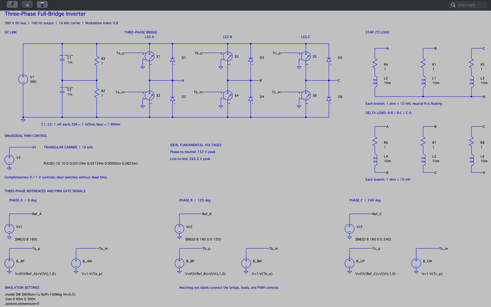
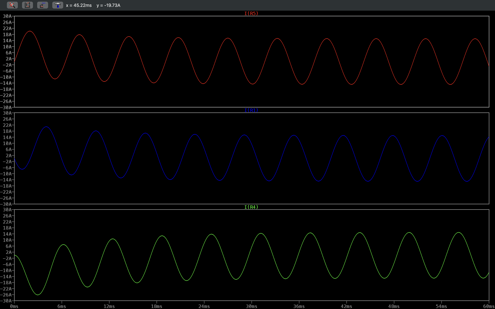
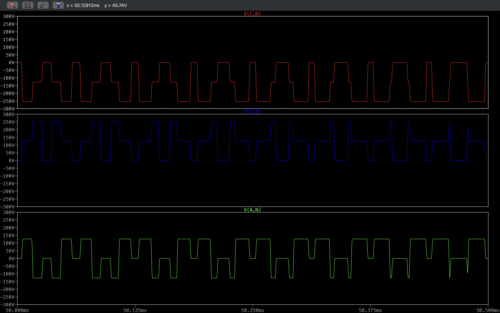
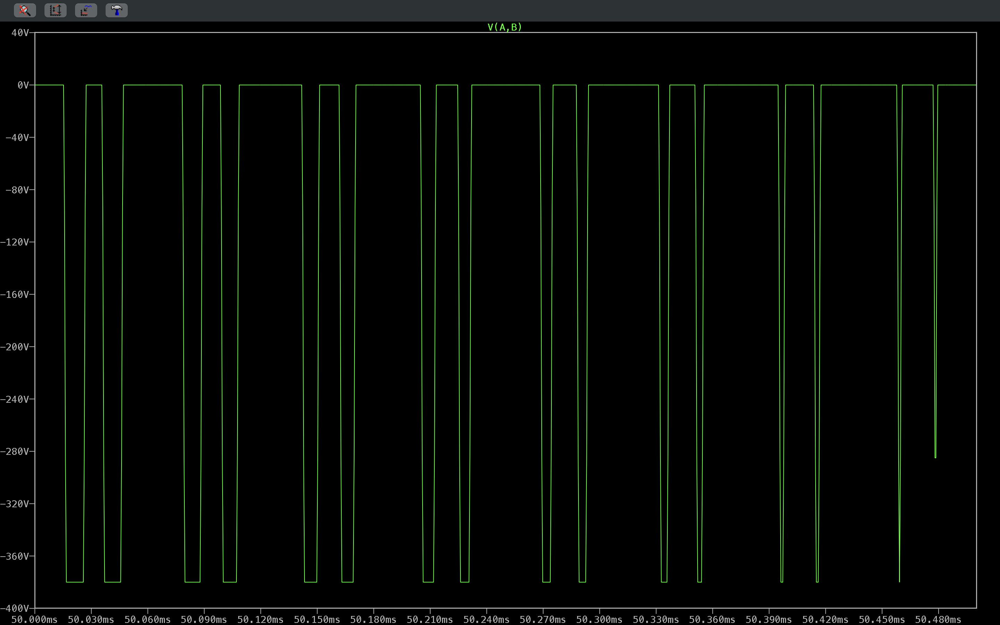
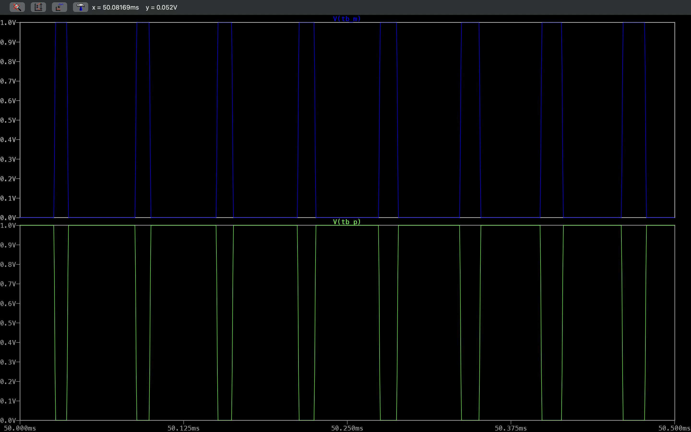

# Three-Phase Full-Bridge Inverter

[](../LICENSE)
[](https://www.analog.com/en/resources/design-tools-and-calculators/ltspice-simulator.html)

Two-level, six-switch three-phase voltage-source inverter running from a 380 V split DC link. Sinusoidal PWM, comparing three 160 Hz references against a 16 kHz triangular carrier at a modulation index of 0.8, drives a star-connected and a delta-connected R-L load at the same time.

Designed to show how sinusoidal PWM synthesises three-phase AC from a DC bus, and to check the simulated phase voltages, line voltages, gate signals, and load currents against the ideal relationships for a two-level inverter.

## Table of Contents
- [Schematic](#schematic)
- [Plots](#plots)
- [Overview](#overview)
- [Specifications](#specifications)
- [Results](#results)
- [Software](#software)
- [Tech Stack](#tech-stack)
- [Repository Structure](#repository-structure)
- [Contact](#contact)
- [License](#license)

## Schematic


## Plots

### Star-Load Phase Currents, 0–60 ms
Currents through R5 (phase C), R1 (phase B), and R4 (phase A) of the star load.



### Phase-to-Neutral Voltages, 50.0–50.5 ms
V(C,N), V(B,N), and V(A,N), measured to the floating star-point N.



### Line-to-Line Voltage, 50.0–50.5 ms


### Phase B Gate Signals, 50.0–50.5 ms
Lower-switch control V(tb_m) (top) and upper-switch control V(tb_p) (bottom).



## Overview

| Section                  | Description |
| ------------------------ | ----------- |
| **DC Link**              | V1 = 380 V feeds two series 1 mF capacitors (ESR 1 mΩ, R<sub>par</sub> 1 MΩ) that form a split bus. R3 and R2 (1 Ω each) sit across C1 and C2 as a resistive midpoint divider. |
| **Three-Phase Bridge**   | Three legs (A, B, C), each with an upper and lower voltage-controlled switch (S1–S6) and an antiparallel freewheeling diode (D1–D6). The switch model is `SW(Ron=1u Roff=100Meg Vt=0.5)`. |
| **Carrier**              | V2 is a ±10 V triangle at 16 kHz (62.5 µs period, 31.24 µs rise and fall). |
| **References**           | Vc1, Vc2, and Vc3 are 8 V peak, 160 Hz sines at 0°, 120°, and 240°. Their ratio to the carrier peak sets m<sub>a</sub> = 8 / 10 = 0.8. |
| **PWM Gate Logic**       | For each phase, `V=if(V(Ref)>V(Vt),1,0)` drives the upper switch, and `V=1−V(T_p)` drives the lower switch with the complement. There is no dead time. |
| **Star (Y) Load**        | Three 1 Ω + 10 mH branches from A, B, and C to a floating neutral N. |
| **Delta Load**           | Three 1 Ω + 10 mH branches connected A–B, B–C, and C–A. |

### Design Calculations

| Quantity | Formula | Value |
| --- | --- | --- |
| **Amplitude modulation index** | m<sub>a</sub> = V<sub>ref</sub> / V<sub>carrier</sub> | 0.8 |
| **Frequency modulation ratio** | m<sub>f</sub> = f<sub>carrier</sub> / f<sub>out</sub> | 100 |
| **Phase-to-neutral fundamental** | V<sub>ph</sub> = m<sub>a</sub> · V<sub>dc</sub> / 2 | 152 V peak |
| **Line-to-line fundamental** | V<sub>LL</sub> = √3 · V<sub>ph</sub> | 263.3 V peak |
| **Branch impedance at 160 Hz** | Z = 1 + j·2π·160·0.01 | 1 + j10.05 Ω (10.10 Ω ∠84.3°) |
| **Star-load phase current** | I = V<sub>ph</sub> / \|Z\| | 15.05 A peak |
| **Delta-load branch current** | I = V<sub>LL</sub> / \|Z\| | 26.1 A peak |
| **Load time constant** | τ = L / R | 10 ms |

## Specifications

| Parameter                   | Value |
| --------------------------- | ----- |
| **Topology**                | Two-level, six-switch voltage-source inverter |
| **DC Link**                 | 380 V, 2 × 1 mF split capacitors |
| **Output Frequency**        | 160 Hz |
| **Carrier Frequency**       | 16 kHz triangle, ±10 V |
| **Modulation**              | Sinusoidal PWM, m<sub>a</sub> = 0.8, m<sub>f</sub> = 100 |
| **Switches**                | Ideal, R<sub>on</sub> = 1 µΩ, R<sub>off</sub> = 100 MΩ, V<sub>t</sub> = 0.5 V |
| **Gate Signals**            | Complementary 0 / 1 V, no dead time |
| **Star Load**               | 3 × (1 Ω + 10 mH), floating neutral |
| **Delta Load**              | 3 × (1 Ω + 10 mH) |
| **Analysis**                | `.tran 0 60m 0 500n` (500 ns maximum step) |

## Results

Values read from the LTspice waveform viewer:

| Measurement                       | Expected              | Simulated             | Notes |
| --------------------------------: | --------------------: | --------------------: | ----: |
| **Phase-to-neutral levels**       | 0, ±126.7, ±253.3 V   | 0, ±127, ±253 V       | ±V<sub>dc</sub>/3, ±2V<sub>dc</sub>/3 |
| **Line-to-line levels**           | 0, ±380 V             | 0, −380 V             | V(A,B), in the 50.0–50.5 ms window |
| **Star phase current (steady)**   | 15.05 A peak          | ≈ 15 A peak           | All three phases, after ≈ 40 ms |
| **Star phase current (startup)**  | —                     | ≈ 20–26 A peak        | First cycle, includes DC offset |
| **Offset decay**                  | τ = 10 ms             | Settled by ≈ 40 ms    | About 4τ |
| **Phase B upper-switch duty**     | ≈ 0.85                | ≈ 0.85                | At 50 ms, Ref_B ≈ 6.9 V |
| **Gate complementarity**          | V(tb_p) + V(tb_m) = 1 | Exact                 | No overlap, no dead time |
| **PWM period**                    | 62.5 µs               | 62.5 µs               | 8 pulses in 0.5 ms |

### Discussion

**Phase voltages.** Each leg output switches between 0 and 380 V. Referenced to the floating star-point, each phase voltage depends on the switch states of all three legs, so V(A,N), V(B,N), and V(C,N) take the five levels 0, ±V<sub>dc</sub>/3, and ±2V<sub>dc</sub>/3. The plotted levels of ≈ ±127 V and ≈ ±253 V match these exactly. Because the load is balanced and the neutral floats, the three phase-to-neutral voltages always sum to zero.

**Line voltage.** The line-to-line voltage V(A,B) is the difference of two leg outputs, so it is three-level: 0 or ±380 V. In the 50.0–50.5 ms window phase A is below phase B on average, so only the 0 and −380 V levels appear. The pulse widths change from one carrier period to the next as the two references move, and the narrowing pulses at the right of the plot show V(A,B) approaching a zero crossing of its fundamental.

**Gate signals.** At t = 50 ms, exactly eight output cycles after t = 0, the phase B reference is 8·sin(120°) = 6.93 V. Against the ±10 V carrier this gives an expected upper-switch duty of (1 + 6.93/10) / 2 = 0.85, which matches the ≈ 85% high time of V(tb_p). V(tb_m) is its exact complement, and the two are never high together, so neither leg ever shoots through.

**Load currents.** The 10 mH inductance gives each branch a reactance of 10.05 Ω at 160 Hz, ten times the 1 Ω resistance. This makes the load mostly inductive (84.3°) and filters the 16 kHz switching ripple out of the current, so the phase currents are smooth sinusoids even though the voltages are pulse trains. The current settles to ≈ 15 A peak, which matches the 15.05 A calculated from the 152 V fundamental. During the first few cycles each current carries a decaying DC offset, because the inductor current must start at zero rather than at its steady-state value. The offset decays with the 10 ms L/R time constant, so the three phases have the same amplitude by about 40 ms.

### Limitations

- The switches are ideal, with no dead time, so the simulation shows no dead-time distortion, switching loss, or diode reverse recovery.
- V1 is an ideal source, so the DC link does not sag or ripple. R2 and R3 (1 Ω each) form a midpoint divider directly across the 380 V bus. They draw 190 A from V1 but do not affect the bridge, because the source is ideal.
- Phase B's reference leads phase A by 120° and phase C's lags by 120°, so the phase sequence is A–C–B. Swapping the B and C phase angles gives the A–B–C sequence.
- No harmonic (FFT) analysis of the output voltage or current was performed.

## Software

### Running

1. Install LTspice (tested with 17.2.4).
2. Open [`Simulation/LTspice_Files/Three_Phase_Full_Bridge_Inverter_Simulation.asc`](Simulation/LTspice_Files/Three_Phase_Full_Bridge_Inverter_Simulation.asc).
3. Run the simulation; the switch model, `.tran`, and `.options` directives are on the schematic.
4. Plot I(R4), I(R1), and I(R5) over 0–60 ms to reproduce the star-load currents.
5. Plot V(A,N), V(B,N), V(C,N), V(A,B), V(tb_p), and V(tb_m), and zoom to 50.0–50.5 ms to reproduce the switching-interval plots.
6. Change the reference amplitude in Vc1–Vc3 to vary the modulation index, or the PULSE period in V2 to vary the carrier frequency.

## Tech Stack

| Circuit Simulation | Version Control | Repository Hosting |
| :----------------: | :-------------: | :----------------: |
|  |  |  |

## Repository Structure

```text
Three_Phase_Full_Bridge_Inverter
├── Docs                                                                           Contains simulation images
│   └── Images
│       ├── Plots                                                                  Contains exported waveform plots
│       │   ├── Three_Phase_Full_Bridge_Inverter_Plot_Transient_Phase_A_To_Phase_B_Line_To_Line_Voltage_Switching_Interval_Zoom.png
│       │   │                                                                      V(A,B), 50.0–50.5 ms
│       │   ├── Three_Phase_Full_Bridge_Inverter_Plot_Transient_Phase_B_Upper_And_Lower_PWM_Control_Voltages_Complementary_Switching_Zoom.png
│       │   │                                                                      Phase B gate signals, 50.0–50.5 ms
│       │   ├── Three_Phase_Full_Bridge_Inverter_Plot_Transient_Star_Connected_Load_Phase_Currents_Startup_And_Steady_State_Response.png
│       │   │                                                                      Star-load phase currents, 0–60 ms
│       │   └── Three_Phase_Full_Bridge_Inverter_Plot_Transient_Three_Phase_To_Neutral_Voltages_PWM_Switching_Interval_Zoom.png
│       │                                                                          Phase-to-neutral voltages, 50.0–50.5 ms
│       └── Schematics                                                             Contains the schematic image
│           └── Three_Phase_Full_Bridge_Inverter_Schematic.png                     Schematic in PNG format
├── Simulation
│   └── LTspice_Files
│       └── Three_Phase_Full_Bridge_Inverter_Simulation.asc                        LTspice schematic and simulation file
└── README.md                                                                      Simulation README
```

## Contact
- GitHub: [@devjamescollier](https://github.com/devjamescollier)
- Email: [jwcollie@usc.edu](mailto:jwcollie@usc.edu)

## License

Copyright © 2026 James Collier

This project is licensed under the MIT License. See [LICENSE](../LICENSE).
