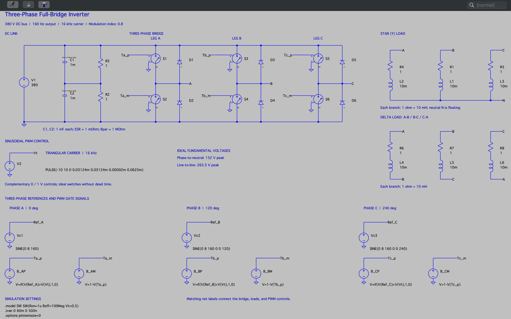
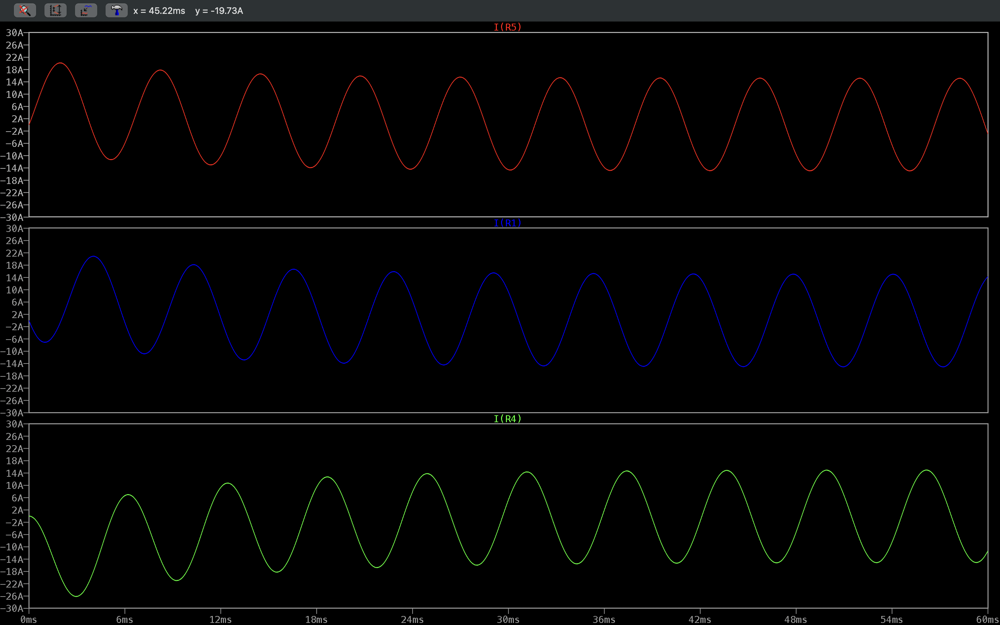
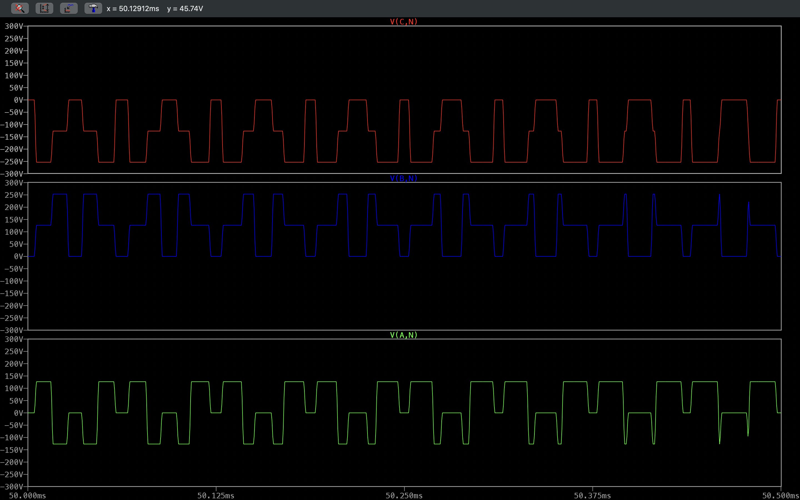
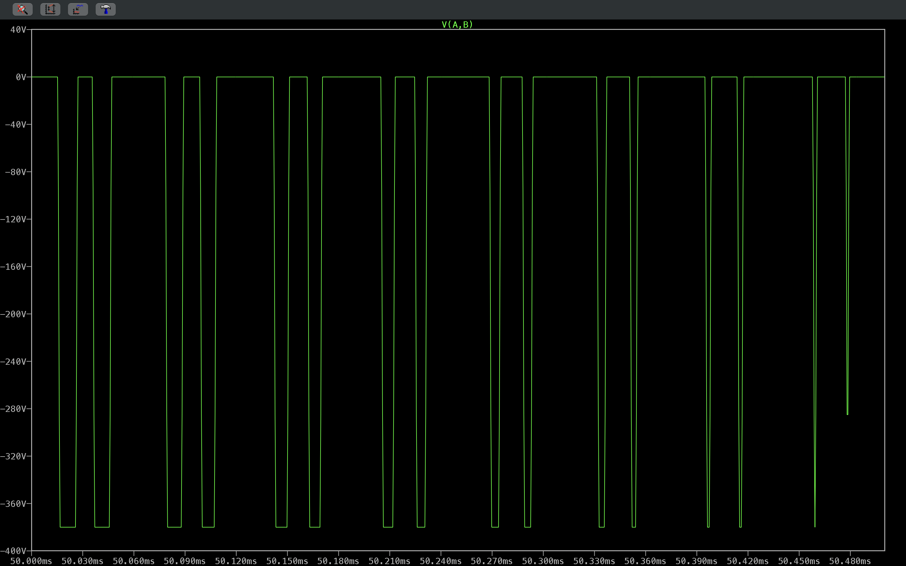
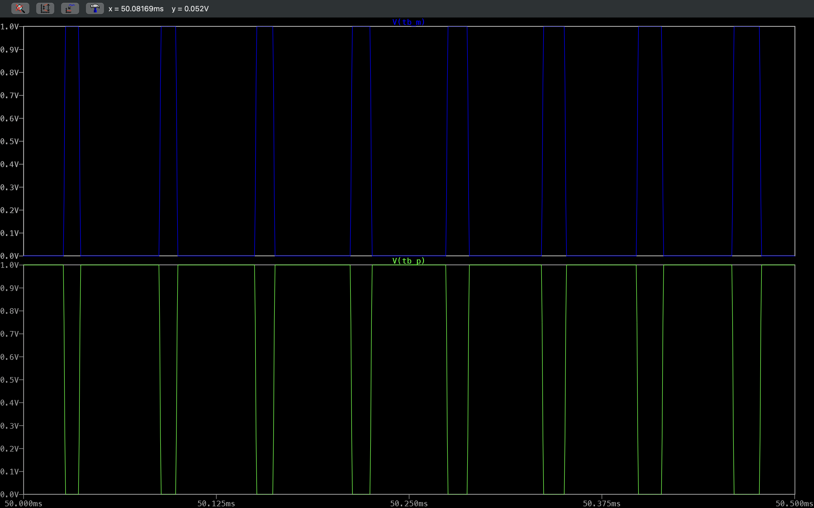

# Three-Phase Full-Bridge Inverter


This LTspice study models a two-level, three-phase full-bridge inverter. Sinusoidal PWM converts a 380 V DC link into 160 Hz three-phase output across a star (Y) load and a delta load. The directory contains the native schematic, a schematic capture, and four transient captures: star-load phase currents over the full 60 ms run, plus switching-interval zooms of the phase-to-neutral voltages, one line-to-line voltage, and the complementary Phase B control signals.

The engineering question is how a carrier-comparison PWM scheme produces balanced three-phase currents in an inductive load. The switches are ideal voltage-controlled switches driven by 0/1 V behavioral control signals, so the study shows modulation and load behavior in simulation rather than the behavior of physical power devices or gate drivers.

## Table of Contents

- [Schematic](#schematic)
- [Simulation Plots](#simulation-plots)
- [Overview](#overview)
- [Specifications](#specifications)
- [Results](#results)
- [Simulation Setup](#simulation-setup)
- [Running the Simulation](#running-the-simulation)
- [Tech Stack](#tech-stack)
- [Tools and Environment](#tools-and-environment)
- [Repository Structure](#repository-structure)
- [References and Attribution](#references-and-attribution)
- [Contact](#contact)
- [License](#license)

## Schematic

[](Docs/Images/Schematics/Three_Phase_Full_Bridge_Inverter_Schematic.png)

Native LTspice source: [Three_Phase_Full_Bridge_Inverter_Simulation.asc](Simulation/LTspice_Files/Three_Phase_Full_Bridge_Inverter_Simulation.asc)

## Simulation Plots

### Star-Load Phase Currents

[](Docs/Images/Plots/Three_Phase_Full_Bridge_Inverter_Plot_Transient_Star_Connected_Load_Phase_Currents_Startup_And_Steady_State_Response.png)

*Transient analysis, 0-60 ms. Panes show `I(R5)` (Phase C), `I(R1)` (Phase B), and `I(R4)` (Phase A), the currents in the three star-load branches. Each resistor is in series with its 10 mH inductor, so these equal the branch inductor currents. The currents start with a decaying DC offset and settle into balanced sinusoids of about ±15 A peak at 160 Hz. They are star-branch currents, not total inverter terminal currents, because the delta load is also connected.*

### Phase-to-Neutral Voltages

[](Docs/Images/Plots/Three_Phase_Full_Bridge_Inverter_Plot_Transient_Three_Phase_To_Neutral_Voltages_PWM_Switching_Interval_Zoom.png)

*Transient zoom, 50.0-50.5 ms (eight 62.5 µs carrier periods). The panes show `V(C,N)`, `V(B,N)`, and `V(A,N)`, each measured to the floating star neutral `N`. The raw PWM waveforms step among 0 V, about ±127 V, and about ±253 V (0, ±Vdc/3, ±2Vdc/3). This is a switching-interval view, not a full fundamental cycle.*

### Line-to-Line Voltage

[](Docs/Images/Plots/Three_Phase_Full_Bridge_Inverter_Plot_Transient_Phase_A_To_Phase_B_Line_To_Line_Voltage_Switching_Interval_Zoom.png)

*Transient zoom of `V(A,B)` over the same switching interval. In this part of the fundamental cycle the line-to-line voltage pulses between 0 V and about −380 V (the full DC bus), and the pulse widths change from one carrier period to the next. Other parts of the cycle produce +380 V pulses that are not shown in this window.*

### Phase B PWM Control Signals

[](Docs/Images/Plots/Three_Phase_Full_Bridge_Inverter_Plot_Transient_Phase_B_Upper_And_Lower_PWM_Control_Voltages_Complementary_Switching_Zoom.png)

*Transient zoom of the behavioral control voltages `V(Tb_p)` (upper switch S3) and `V(Tb_m)` (lower switch S4) over 50.0-50.5 ms. The signals are exact 0/1 V complements with no dead time. In this window the upper control is high for most of each carrier period, because the Phase B reference is near its positive peak. These are ideal switch-control signals, not physical gate-driver waveforms.*

## Overview

| Section | Description |
| --- | --- |
| DC link | `V1` = 380 V across two series 1 mF capacitors `C1` and `C2` (Rser = 1 mΩ, Rpar = 1 MΩ). `R3` and `R2` (1 Ω each) connect each rail to the capacitor midpoint. |
| Bridge legs | Leg A: `S1`/`S2` with `D1`/`D2`. Leg B: `S3`/`S4` with `D3`/`D4`. Leg C: `S5`/`S6` with `D5`/`D6`. Outputs are nets `A`, `B`, and `C`. |
| Switches | Voltage-controlled switches using `.model SW SW(Ron=1u Roff=100Meg Vt=0.5)`. The freewheeling diodes use the default LTspice diode model. |
| Carrier | `V2` = `PULSE(-10 10 0 0.03124m 0.03124m 0.00002m 0.0625m)`, a ±10 V triangle with a 62.5 µs period (16 kHz) on net `Vt`. |
| Phase references | `Vc1`, `Vc2`, and `Vc3` are 8 V-peak, 160 Hz sines at 0°, 120°, and 240° on `Ref_A`, `Ref_B`, and `Ref_C`. |
| PWM generation | `B_AP`, `B_BP`, and `B_CP` output `if(V(Ref_x)>V(Vt),1,0)` for the upper switches. `B_AM`, `B_BM`, and `B_CM` output `1-V(Tx_p)` for the lower switches. |
| Star load | Phase A: `R4` + `L2`. Phase B: `R1` + `L1`. Phase C: `R5` + `L3`. Each branch is 1 Ω + 10 mH, joined at the floating neutral `N`. |
| Delta load | A-B: `R6` + `L4`. B-C: `R7` + `L5`. C-A: `R8` + `L6`. Each branch is 1 Ω + 10 mH. |

## Specifications

| Parameter | Value | Basis |
| --- | --- | --- |
| DC bus voltage | 380 V | Configured (`V1`) |
| DC-link capacitors | 2 × 1 mF, Rser = 1 mΩ, Rpar = 1 MΩ | Configured (`C1`, `C2`) |
| Fundamental (reference) frequency | 160 Hz | Configured (`Vc1`-`Vc3`) |
| Reference amplitude | 8 V peak | Configured |
| Carrier | ±10 V triangle, 62.5 µs period (16 kHz) | Configured (`V2`) |
| Amplitude modulation index | 0.8 (8 V / 10 V) | Calculated |
| Control levels | 0 V / 1 V, switch threshold 0.5 V | Configured (behavioral sources, `.model SW`) |
| Dead time | None | Configured (exact complements) |
| Load branches | 1 Ω + 10 mH each, star and delta | Configured |
| Ideal fundamental phase-to-neutral voltage | 152 V peak | Calculated: 0.8 × 380 V / 2 |
| Ideal fundamental line-to-line voltage | ≈ 263.3 V peak | Calculated: √3 × 152 V |
| Star-branch impedance at 160 Hz | ≈ 10.10 Ω (X_L ≈ 10.05 Ω) | Calculated |
| Ideal star-branch fundamental current | ≈ 15.0 A peak | Calculated: 152 V / 10.10 Ω |
| Simulated interval | 0-60 ms, 500 ns maximum step | Configured (`.tran 0 60m 0 500n`) |

The 152 V and 263.3 V values are fundamental-component amplitudes. They are not the peaks of the raw PWM pulses, which reach about 253 V phase-to-neutral and 380 V line-to-line.

## Results

| Quantity or Behavior | Result | Evidence | Interpretation |
| --- | --- | --- | --- |
| Star-branch current amplitude | About ±15 A peak after roughly 30 ms | [Phase currents](Docs/Images/Plots/Three_Phase_Full_Bridge_Inverter_Plot_Transient_Star_Connected_Load_Phase_Currents_Startup_And_Steady_State_Response.png) | Simulated observation, agreeing with the calculated ≈ 15.0 A fundamental peak. |
| Startup behavior | DC offset in each branch current that decays over the first few cycles | Same plot | Simulated observation, consistent with the branch L/R time constant of 10 mH / 1 Ω = 10 ms. |
| Phase relationship | Three currents of similar amplitude, displaced by one-third of a cycle | Same plot | Simulated observation of a balanced three-phase set at 160 Hz (period 6.25 ms). |
| Phase-to-neutral voltage levels | 0, about ±127 V, and about ±253 V | [Phase voltages](Docs/Images/Plots/Three_Phase_Full_Bridge_Inverter_Plot_Transient_Three_Phase_To_Neutral_Voltages_PWM_Switching_Interval_Zoom.png) | Simulated observation, matching the expected 0, ±Vdc/3, ±2Vdc/3 levels of a two-level inverter with a floating star neutral. |
| Line-to-line voltage levels | 0 and about −380 V in the displayed window | [Line-to-line voltage](Docs/Images/Plots/Three_Phase_Full_Bridge_Inverter_Plot_Transient_Phase_A_To_Phase_B_Line_To_Line_Voltage_Switching_Interval_Zoom.png) | Simulated observation. Line-to-line pulses span the full bus. The window covers only 0.5 ms of a 6.25 ms fundamental period. |
| Phase B complementary control | `V(Tb_p)` and `V(Tb_m)` are exact complements, mostly high and low respectively | [PWM control](Docs/Images/Plots/Three_Phase_Full_Bridge_Inverter_Plot_Transient_Phase_B_Upper_And_Lower_PWM_Control_Voltages_Complementary_Switching_Zoom.png) | Simulated observation. At t = 50 ms the Phase B reference is about +6.9 V (calculated), which gives a long upper-switch on-time in each carrier period. |

**Modeling assumptions and scope.** The switches are ideal resistive switches with no dead time, the diodes use the default model, and the control signals are ideal 0/1 V sources. The DC source is stiff. The 1 Ω resistors `R2` and `R3` hold the capacitor midpoint at 190 V. With an ideal 380 V source, each would dissipate about 36 kW in calculation (190 V² / 1 Ω), so they are a simulation convenience and not a realistic balancing network. The study does not establish THD, efficiency, switching losses, shoot-through immunity, motor behavior, or suitability for real hardware.

## Simulation Setup

Active directives in `Three_Phase_Full_Bridge_Inverter_Simulation.asc`:

```spice
.model SW SW(Ron=1u Roff=100Meg Vt=0.5)
.tran 0 60m 0 500n
.options plotwinsize=0
```

- The bridge, loads, and control sources are connected by matching net labels: `A`, `B`, `C`, `N`, `Vt`, `Ref_A`/`Ref_B`/`Ref_C`, `Ta_p`/`Ta_m`, `Tb_p`/`Tb_m`, and `Tc_p`/`Tc_m`.
- `V(A,N)` is a phase-to-neutral voltage measured to the floating star neutral. `V(A,B)` is a phase-to-phase (line-to-line) voltage.
- The switch instances have no explicit value. LTspice's default `sw` symbol value is `SW`, which matches the `.model SW` directive.

## Running the Simulation

1. Obtain this repository and open `Simulation/LTspice_Files/Three_Phase_Full_Bridge_Inverter_Simulation.asc` in LTspice.
2. Dependencies: none beyond LTspice's built-in switch and diode elements. The switch model is defined inline.
3. Run the configured transient analysis.
4. Add the traces for each saved view:
   ```text
   I(R4)    I(R1)    I(R5)
   V(A,N)   V(B,N)   V(C,N)
   V(A,B)
   V(Tb_p)  V(Tb_m)
   ```
5. View the currents over the full 0-60 ms interval. Zoom the voltage and control traces to 50.0-50.5 ms to compare with the switching-interval captures.

No `.plt` plot-settings file was saved, so the traces and panes must be selected manually.

## Tech Stack

| Category | Technology |
| --- | --- |
| Circuit Simulation |  |
| Version Control |  |
| Hosting |  |

## Tools and Environment

| Tool | Details |
| --- | --- |
| Simulator | LTspice. LTspice 17.2.4 is installed in the documentation environment; the version used for the original captures was not recorded. |
| Operating system | macOS |
| Device models | Inline `.model SW SW(...)` and the LTspice default diode |

## Repository Structure

```text
Three_Phase_Full_Bridge_Inverter/
├── Docs/
│   └── Images/
│       ├── Plots/
│       │   ├── Three_Phase_Full_Bridge_Inverter_Plot_Transient_Phase_A_To_Phase_B_Line_To_Line_Voltage_Switching_Interval_Zoom.png               # V(A,B) zoom
│       │   ├── Three_Phase_Full_Bridge_Inverter_Plot_Transient_Phase_B_Upper_And_Lower_PWM_Control_Voltages_Complementary_Switching_Zoom.png     # Phase B controls
│       │   ├── Three_Phase_Full_Bridge_Inverter_Plot_Transient_Star_Connected_Load_Phase_Currents_Startup_And_Steady_State_Response.png          # 0-60 ms star currents
│       │   └── Three_Phase_Full_Bridge_Inverter_Plot_Transient_Three_Phase_To_Neutral_Voltages_PWM_Switching_Interval_Zoom.png                   # V(x,N) zoom
│       └── Schematics/
│           └── Three_Phase_Full_Bridge_Inverter_Schematic.png        # Schematic capture
├── Simulation/
│   └── LTspice_Files/
│       └── Three_Phase_Full_Bridge_Inverter_Simulation.asc           # Native LTspice schematic
└── README.md
```

## References and Attribution

- This study was selected from an existing collection of LTspice example circuits and then used by James Collier for simulation, waveform inspection, schematic annotation, and documentation. Sinusoidal PWM of a two-level three-phase bridge is a standard technique and is not presented as an original invention.
- No upstream source credit, license, or URL is recorded in the local source file.

## Contact

- GitHub: [@devjamescollier](https://github.com/devjamescollier)
- Email: [jwcollie@usc.edu](mailto:jwcollie@usc.edu)

## License

No repository-wide license is declared. Original circuit sources and third-party models remain subject to their respective terms.
